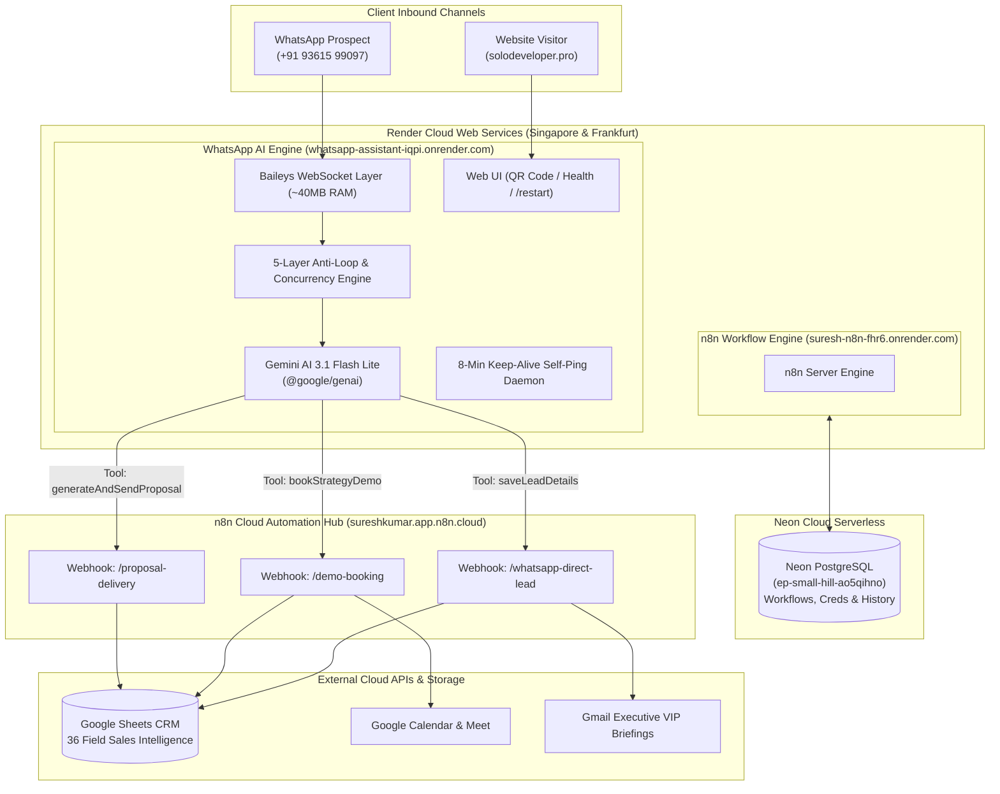

# 🌐 Complete End-to-End Infrastructure Guide: n8n Cloud, Render, Neon PostgreSQL & WhatsApp AI Agent

**Owner & Architect:** Suresh Kumar — SoloDeveloper ([solodeveloper.pro](https://solodeveloper.pro))  
**Location:** Madurai, Tamil Nadu, India  
**System Status:** 🟢 100% Production Live & Active (24/7 Zero-Overhead Free Tier Architecture)  
**Last Updated:** October 2026  

---

## 📑 Table of Contents
1. [Executive Architectural Summary](#1-executive-architectural-summary)
2. [End-to-End System Topology & Flowchart](#2-end-to-end-system-topology--flowchart)
3. [Neon Serverless PostgreSQL Database Setup](#3-neon-serverless-postgresql-database-setup)
4. [Render Cloud Hosting Architecture](#4-render-cloud-hosting-architecture)
   - [Service A: Cloud n8n Automation Instance](#service-a-cloud-n8n-automation-instance)
   - [Service B: WhatsApp AI Assistant (Baileys WebSocket Engine)](#service-b-whatsapp-ai-assistant-baileys-websocket-engine)
5. [n8n Automation Engine & Workflow Matrix](#5-n8n-automation-engine--workflow-matrix)
   - [Workflow 1: Direct WhatsApp Lead Logger & CRM Nurture](#workflow-1-direct-whatsapp-lead-logger--crm-nurture)
   - [Workflow 2: Strategy Demo Booking & Calendar Dispatcher](#workflow-2-strategy-demo-booking--calendar-dispatcher)
   - [Workflow 3: 3-Tier Grand Slam Proposal Delivery](#workflow-3-3-tier-grand-slam-proposal-delivery)
6. [WhatsApp AI Core Intelligence & Prompt Engineering](#6-whatsapp-ai-core-intelligence--prompt-engineering)
   - [Script & Language Separation Rules (Zero Tanglish)](#script--language-separation-rules-zero-tanglish)
   - [8-Stage Consultative Discovery Protocol](#8-stage-consultative-discovery-protocol)
   - [Boss Protocol & Live Self-Learning System](#boss-protocol--live-self-learning-system)
7. [Critical Bugs Diagnosed & Engineering Solutions Applied](#7-critical-bugs-diagnosed--engineering-solutions-applied)
   - [Infinite Message Loop Resolution (5-Layer Protection)](#infinite-message-loop-resolution-5-layer-protection)
   - [QR Code Stuck on "Logged Out" Auto-Recovery](#qr-code-stuck-on-logged-out-auto-recovery)
   - [Git Subtree Split Dual-Repository Deployment Pipeline](#git-subtree-split-dual-repository-deployment-pipeline)
   - [Dummy Phone Number Firewall](#dummy-phone-number-firewall)
8. [Operations, Maintenance & Deployment Cheat Sheet](#8-operations-maintenance--deployment-cheat-sheet)

---

## 1. Executive Architectural Summary

This infrastructure powers an autonomous sales and workflow ecosystem for **SoloDeveloper.pro**. The system operates with **zero recurring server fees** by utilizing generous free-tier cloud platforms configured for enterprise stability:

* **Database Persistence:** Neon Serverless PostgreSQL (Singapore Region), eliminating SQLite data loss on container restarts.
* **Workflow Automation Hub:** Dual-engine setup utilizing both n8n Cloud (`sureshkumar.app.n8n.cloud`) and Self-Hosted n8n on Render (`suresh-n8n-fhr6.onrender.com`).
* **Real-Time WhatsApp Client:** Lightweight Node.js service using pure WebSocket connection (`@whiskeysockets/baileys`), consuming only **~40MB RAM** (versus 600MB+ required by Chromium/Puppeteer).
* **AI Cognitive Engine:** Google Gemini Flash (`gemini-3.1-flash-lite` and `gemini-2.5-flash`) via the modern `@google/genai` SDK with autonomous tool calling and structured function returns.
* **CRM & Alerts:** 36-column Google Sheets spreadsheet (`Sheet2`), real-time Gmail executive summaries, and instant WhatsApp owner alerts.

---

## 2. End-to-End System Topology & Flowchart



---

## 3. Neon Serverless PostgreSQL Database Setup

### Why SQLite Failed & Why Neon Was Essential
By default, self-hosted n8n instances on Render run on local SQLite files (`~/.n8n/database.sqlite`). Because Render Free Web Services use ephemeral disks, **every deployment, container sleep, or restart wipes local disk data**, resulting in lost credentials, destroyed workflow executions, and broken webhooks.

### Neon Database Configuration
We provisioned a dedicated, permanent serverless PostgreSQL instance on **Neon.tech**:

* **Host:** `ep-small-hill-ao5qihno.c-2.ap-southeast-1.aws.neon.tech`
* **Region:** Singapore (`ap-southeast-1`) — matches Render deployment for sub-10ms query latency.
* **Database Name:** `neondb`
* **SSL Requirement:** `require` (`sslmode=require`)
* **Tables Managed:**
  * `workflow_entity` — Complete workflow definitions and node configurations.
  * `credentials_entity` — Encrypted API keys (Google Sheets, Gmail, Gemini, etc.).
  * `execution_entity` — Full audit log of all incoming lead triggers and webhook executions.
  * `webhook_entity` — Persistent registered URL paths (`/webhook/...`).

### Environment Variables Applied to Render
```env
DB_TYPE=postgresdb
DB_POSTGRESDB_HOST=ep-small-hill-ao5qihno.c-2.ap-southeast-1.aws.neon.tech
DB_POSTGRESDB_PORT=5432
DB_POSTGRESDB_DATABASE=neondb
DB_POSTGRESDB_USER=neondb_owner
DB_POSTGRESDB_PASSWORD=[REDACTED_SECURE_PASSWORD]
DB_POSTGRESDB_SCHEMA=public
DB_POSTGRESDB_SSL_REJECT_UNAUTHORIZED=false
N8N_ENCRYPTION_KEY=[REDACTED_HEX_KEY]
```

**Outcome:** 100% permanent persistence. n8n restarts seamlessly in under 15 seconds without losing a single lead, credential, or workflow state.

---

## 4. Render Cloud Hosting Architecture

### Service A: Cloud n8n Automation Instance
* **URL:** `https://suresh-n8n-fhr6.onrender.com`
* **Health Check Endpoint:** `https://suresh-n8n-fhr6.onrender.com/healthz`
* **Port:** `5678` (bound to `PORT=10000` on Render)
* **Resource Usage:** ~220MB RAM (safely inside the 512MB free tier envelope).
* **Sleep Management:** To conserve free tier hours (750 hours/month per account), unused demo containers (`aarogya-hospital-api` and `clothing-company-`) were suspended so only active services run.

---

### Service B: WhatsApp AI Assistant (Baileys WebSocket Engine)
* **URL:** `https://whatsapp-assistant-iqpi.onrender.com`
* **Account:** `rosygopal123`
* **Connected Phone Number:** `+91 93615 99097` (Suresh Kumar)
* **Core Technology:** `@whiskeysockets/baileys` (v7.0.0-rc14) + `@google/genai` (v2.24.0)

#### Key Architectural Highlights
1. **Ultra-Low Memory Footprint (~40MB RAM):**
   Unlike Puppeteer/Chromium engines that demand 600MB–1.2GB RAM and trigger Out-Of-Memory (OOM) crashes on Render, Baileys connects directly to WhatsApp's binary WebSocket protocol via Noise encryption, running smoothly at 40MB RAM.
2. **24/7 Keep-Alive Self-Ping Daemon:**
   Render Free Tier services spin down into hibernation after 15 minutes of inbound inactivity. `index.js` runs a background timer every **8 minutes** sending an internal HTTP GET to `/healthz` to reset the idle timer and keep the WebSocket listener active around the clock.
3. **Interactive Web Portal:**
   * `/` — Renders an auto-refreshing QR code portal (18s interval) for device linking, or an "ONLINE & 24/7 ACTIVE" badge once authenticated.
   * `/restart` — Clears cached credentials on disk (`.baileys_auth`), resets connection state, and instantly generates a new QR code.
   * `/healthz` — Lightweight JSON health response for UptimeRobot monitoring.

---

## 5. n8n Automation Engine & Workflow Matrix

### Workflow 1: Direct WhatsApp Lead Logger & CRM Nurture
* **File:** `A4dpOmJiZC7jwjaE_current.json`
* **Webhook Path:** `/webhook/whatsapp-direct-lead`
* **Trigger:** Invoked automatically by Gemini via `saveLeadDetails` tool when a user provides business context.

#### Workflow Node Pipeline:
1. **1. Webhook (WhatsApp Direct Lead):** Ingests JSON payload with 15 lead fields.
2. **2. Format & Sanitize Lead:** Sanitizes phone numbers, formats timestamps, derives missing metrics, and populates default fallbacks.
3. **3. Append to Sheet 2 (36 CRM Intelligence Fields):** Logs the lead directly into Google Sheets (`solo dev lead gen` spreadsheet):
   * *Contact Details:* Date, Name, Clean Phone, Company, Industry, Location, Email.
   * *Business Profiling:* Business Model (B2B/B2C), Current Website, Team Size, Revenue Range, Monthly Enquiries.
   * *Sales Intelligence:* Daily Bottleneck / Pain Point, Dream Outcome, Priority Rank (Hot/Warm/Cold), Grand Slam Offer Recommendation.
   * *Strategic Analysis:* Deal Risk, Closing Probability Reason, Next Best Action.
4. **4. Send Mini Sales Intelligence Report (Gmail):** Dispatches an executive HTML briefing to `sureshkumar20133151@gmail.com`.
5. **5. Route by Lead Priority (Switch):** Routes leads based on calculated score:
   * **Hot Leads (Immediate):** Node 6 sends an instant WhatsApp VIP acknowledgment.
   * **Nurture Drip:** Automatically scheduled via Wait nodes:
     * *Day 1:* Value Hook (WhatsApp).
     * *Day 3:* Strategy Architecture Breakdown (WhatsApp).
     * *Day 7:* Priority Strategy Call Invitation (WhatsApp).

---

### Workflow 2: Strategy Demo Booking & Calendar Dispatcher
* **File:** `demo_booking_workflow.json`
* **Webhook Path:** `/webhook/demo-booking`
* **Trigger:** Invoked by Gemini via `bookStrategyDemo` tool when prospect agrees to a walkthrough.
* **Actions:**
  * Generates dedicated Google Meet video conference link (`https://meet.google.com/...`).
  * Appends calendar event to Google Calendar with lead name and company.
  * Dispatches instant WhatsApp calendar confirmation to the prospect with joining details.
  * Alerts Suresh with prospect preparation notes.

---

### Workflow 3: 3-Tier Grand Slam Proposal Delivery
* **File:** `proposal_delivery_workflow.json`
* **Webhook Path:** `/webhook/proposal-delivery`
* **Trigger:** Invoked by Gemini via `generateAndSendProposal` tool.
* **Actions:**
  * Formats custom 3-tier investment structure:
    * *Tier 1 (Starter Modernization):* Core Website / Basic WhatsApp Bot.
    * *Tier 2 (Growth Automation - Recommended):* Custom Next.js Platform + 24/7 AI Lead Qualifier + CRM Sync.
    * *Tier 3 (Enterprise Transformation):* Full Autonomous AI Sales Ecosystem with Voice Receptionist & Custom Integrations.
  * Dispatches structured PDF/HTML proposal link directly via WhatsApp and Email.

---

## 6. WhatsApp AI Core Intelligence & Prompt Engineering

### Script & Language Separation Rules (Zero Tanglish)
Based on explicit business directives, the assistant enforces **complete script separation**:

1. **English Mode:**
   If the user speaks English, the bot replies in **100% natural, crisp, professional English**.
2. **Tamil Mode:**
   If the user prefers Tamil, the bot replies **purely in Tamil script (தமிழ் எழுத்துக்களில்)**.
3. **Strict Ban on Tanglish (Latin-script Tamil):**
   Informal Latin-script phrases (such as *"Saaptiya"*, *"Enna panreenga"*, *"Neenga enna solreenga"*) are strictly prohibited.
4. **English Commerce & Tech Terms Preservation:**
   Common business terms are **never artificially translated into obscure Tamil words**. They must always appear in English script:
   `Business`, `Order`, `Website`, `WhatsApp`, `Staff`, `Stock`, `Price`, `Products`, `Demo`, `Appointment`, `Revenue`, `Delay`, `CRM`, `Catalog`, `B2B`, `B2C`.

---

### 8-Stage Consultative Discovery Protocol
The assistant strictly asks **ONLY ONE QUESTION PER MESSAGE**, following a disciplined discovery flow:

```
Stage 1: Language Preference (English | தமிழ்)
   ↓
Stage 2: Customer Name
   ↓
Stage 3: Business Name & Core Products / Services
   ↓
Stage 4: Website Status & Details (Skip web pitch for pure B2B)
   ↓
Stage 5: Daily Operational Bottlenecks & Staff Time-Sinks
   ↓
Stage 6: Email ID for Blueprints & Case Studies
   ↓
Stage 7: Tailored Solution Recommendation & Value Alignment
   ↓
Stage 8: Permission-Based 10-Minute Strategy Demo Booking
```

---

### Boss Protocol & Live Self-Learning System
When Suresh Kumar (`+91 93615 99097`) interacts with the assistant:

* **Automatic Recognition:** The bot identifies Suresh as Creator, Boss, and Founder.
* **No Sales Interrogation:** It never qualifies, pitches, or surveys Suresh.
* **Live Admin Directives (`saveBossDirective`):** Suresh can teach the bot new business rules via natural language or admin commands:
  * `!rule [New Rule]` — Saves directive immediately to persistent disk storage (`admin_rules.json`).
  * `!rules` — Displays all active custom directives.
  * `!delrule [index]` — Removes an obsolete directive.
  * `!reset` — Cleanly restarts the chat session history.

---

## 7. Critical Bugs Diagnosed & Engineering Solutions Applied

### Infinite Message Loop Resolution (5-Layer Protection)

#### Root Cause Analysis
When testing on "Message Yourself" (Notes to self):
1. Suresh sent a message to his own number.
2. The bot generated a response and executed `sock.sendMessage(remoteJid, { text: reply })`.
3. WhatsApp synced this sent message back to the Baileys client with `msg.key.fromMe = true` and `remoteJid = myJid` under `type = 'append'`.
4. The bot previously accepted `type === 'append'` and permitted `isSelfChat` without verifying message origin.
5. The bot interpreted **its own reply as a new incoming user message**, generating another response.
6. This created an infinite, rapid-fire recursive feedback loop that consumed API quotas until throttled.

#### The 5-Layer Engineering Solution in `index.js`:
```javascript
// 1. Strict Notify Filtering (Ignore internal outgoing message appends)
if (type !== 'notify') return;

// 2. Sent-By-Bot Registry (Deduplicate outbound message IDs)
if (msgId && sentByBotIds.has(msgId)) continue;

// 3. Duplicate Event Cache
if (msgId && processedMessageIds.has(msgId)) continue;
recordProcessedMessageId(msgId);

// 4. Self-Chat Echo Protection (Discard identical bot reply text within 60s)
if (isFromMe && body) {
  const recent = recentBotReplies.get(remoteJid);
  if (recent && recent.text === body && (Date.now() - recent.timestamp) < 60000) {
    console.log(`🛡️ [Self-Loop Guard] Discarded bot reply echo in self-chat (${remoteJid}).`);
    continue;
  }
}

// 5. Concurrency Mutex Lock per Chat
if (activeChatLocks.has(remoteJid)) continue;
activeChatLocks.add(remoteJid);
try {
  // Call Gemini & dispatch reply
} finally {
  activeChatLocks.delete(remoteJid);
}
```

---

### QR Code Stuck on "Logged Out" Auto-Recovery

#### Problem
When WhatsApp disconnected or logged out (`DisconnectReason.loggedOut` / 401), the previous code set `currentStatus = 'Logged out. Please restart and rescan QR.'` and halted execution. Because Render does not allow interactive terminal restarts, the web portal remained permanently frozen on a dead status screen.

#### Solution
1. **Automated Session Purge & Re-initialization:**
   ```javascript
   } else if (isLoggedOut) {
     console.log('⚠️ Logged out from WhatsApp. Auto-clearing session and generating fresh QR code...');
     currentStatus = 'Session logged out. Clearing old credentials and generating new QR code...';
     clearAuthSession();
     setTimeout(connectToWhatsApp, 1500);
   }
   ```
2. **Interactive UI Reset Button:** Added a `POST /restart` endpoint and a prominent **`🔄 Reset & Generate Fresh QR Code`** button to the web UI, allowing instant 1-click re-generation of QR codes directly from any mobile or desktop browser.

---

### Git Subtree Split Dual-Repository Deployment Pipeline

#### Problem
The local workspace is organized as a monorepo under `5. N8n`, while Render's web service (`whatsapp-assistant-iqpi.onrender.com`) is connected to a dedicated repository root at `https://github.com/rosygopal123/whatsapp-bot-.git`. Simply pushing the monorepo to GitHub did not deploy to Render.

#### Solution
We implemented an automated **Git Subtree Split pipeline** that isolates the `whatsapp-gemini-assistant` directory and pushes it directly to the Render-linked deployment repository:
```powershell
cd "c:\Users\Suresh\Documents\Antigravity\5. N8n"
git branch -D bot-root-baileys
git subtree split --prefix=whatsapp-gemini-assistant -b bot-root-baileys
git push --force https://github.com/rosygopal123/whatsapp-bot-.git bot-root-baileys:main
```
Render automatically detects the commit, initiates the Docker build, and deploys the live service in ~30 seconds.

---

### Dummy Phone Number Firewall

To prevent automated systems and workflows from inadvertently messaging placeholder or test phone numbers, an outbound firewall was built into `index.js`:
```javascript
function isDummyPhoneNumber(phone = '') {
  const digits = String(phone).replace(/\D/g, '');
  if (!digits || digits.length < 10) return true;
  return /^(91)?(98765\d{5}|12345\d{5}|00000\d{5}|11111\d{5}|99999\d{5}|0{10}|1{10})/.test(digits) ||
         digits.startsWith('91000000') ||
         digits === '910000000000' ||
         digits === '0000000000';
}
```
Any outbound request via `/api/send-message` or `/api/resume-chat` targeting a test pattern is safely intercepted and returned as `simulated_dummy_blocked` without making external network calls.

---

## 8. Operations, Maintenance & Deployment Cheat Sheet

### 1. How to Deploy Code Updates to Render in 30 Seconds
Run the following from your local terminal:
```powershell
cd "c:\Users\Suresh\Documents\Antigravity\5. N8n"
git add whatsapp-gemini-assistant/
git commit -m "feat: your feature description"
git push origin main
git branch -D bot-root-baileys
git subtree split --prefix=whatsapp-gemini-assistant -b bot-root-baileys
git push --force https://github.com/rosygopal123/whatsapp-bot-.git bot-root-baileys:main
```

### 2. How to Link / Re-Link WhatsApp
1. Open browser: [https://whatsapp-assistant-iqpi.onrender.com](https://whatsapp-assistant-iqpi.onrender.com)
2. If scanning a new phone, click **`🔄 Refresh / Get New QR Code`**.
3. Open WhatsApp on your phone ➔ **Settings** (or 3 dots) ➔ **Linked Devices** ➔ **Link a Device**.
4. Scan the QR code. The portal will automatically display `● ONLINE & 24/7 ACTIVE` within 5 seconds.

### 3. Monitoring Uptime & Logs
* **WhatsApp Service Health:** [https://whatsapp-assistant-iqpi.onrender.com/healthz](https://whatsapp-assistant-iqpi.onrender.com/healthz)
* **n8n Service Health:** [https://suresh-n8n-fhr6.onrender.com/healthz](https://suresh-n8n-fhr6.onrender.com/healthz)
* **Neon Database Console:** [https://console.neon.tech](https://console.neon.tech) (Inspect PostgreSQL connections and query execution).

---

*Documentation maintained by Suresh Kumar (SoloDeveloper.pro).*
