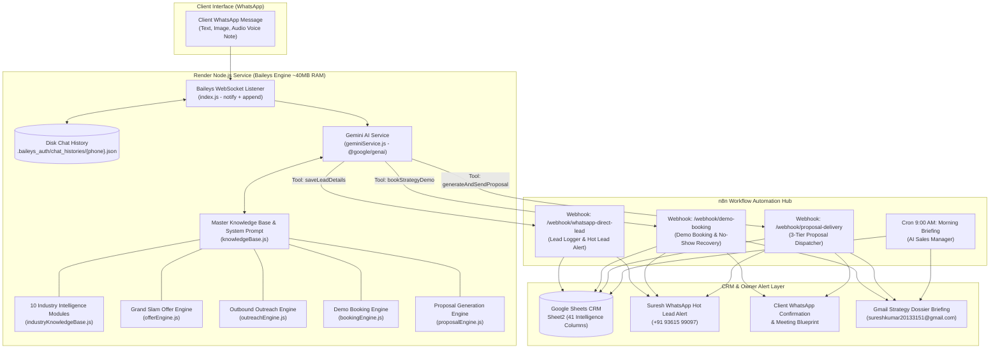

# 🚀 WhatsApp AI Sales Operating System — Complete Technical Dossier

**Owner & Strategist:** Suresh Kumar ([solodeveloper.pro](https://solodeveloper.pro))  
**Positioning:** Freelance Full-Stack Developer & AI Automation Architect, Madurai, Tamil Nadu  
**Architecture:** Zero-Overhead / 100% Free Tier (Baileys WebSocket + Google Gemini 2.5/3.1 + n8n Cloud + Google Sheets CRM)  
**WhatsApp Number:** `+91 93615 99097`  
**Render Deployment:** `https://whatsapp-assistant-iqpi.onrender.com`  
**GitHub Repository:** `https://github.com/rosygopal123/whatsapp-bot-.git` (Branch: `main`)  

---

## 🌟 Executive Summary

Over the development journey, the project evolved from a basic WhatsApp responder into a full-fledged **Autonomous AI Sales Operating System**. It does not merely respond to incoming queries; it:

1. **Acts as a Virtual Sales Strategist** for Suresh Kumar with a defined brand identity and Madurai local context.
2. **Speaks Fluent Bilingual English + Tanglish (Tamil-English)**, adapting dynamically to the client’s comfort level.
3. **Applies Alex Hormozi’s $100M Offers framework** to transform business bottlenecks into structured Grand Slam Offers.
4. **Performs Zero-Interrogation Lead Inference**, capturing up to 41 distinct CRM intelligence attributes behind the scenes without treating prospects to a tedious survey.
5. **Autonomously Books Strategy Demos** into Google Calendar with Google Meet integration.
6. **Dispatches Customized 3-Tier Proposals & Blueprints** via WhatsApp and HTML Email.
7. **Maintains 24/7 Persistent Memory**, retaining conversation state on disk across restarts and server redeploys.

---

## 🏗️ System Architecture & Workflow Flowchart



---

## 📋 Comprehensive Module Breakdown (Steps 1 – 8)

### Step 1: Industry-Specific Intelligence Layer
* **File:** `industryKnowledgeBase.js`
* **Coverage:** 10 core vertical markets:
  1. Construction & Civil Contractors
  2. Clinics & Healthcare
  3. Real Estate Developers & Brokers
  4. Retail Showrooms & Supermarkets
  5. Tuition Centres & EdTech
  6. Restaurants & Cloud Kitchens
  7. Law Firms & Legal Consultants
  8. Manufacturing & B2B Suppliers
  9. Gyms & Fitness Centers
  10. Boutiques & Fashion Stores
* **Functionality:** Identifies vocabulary, operational bottlenecks (e.g., contractor on-site delays), buying triggers, and customer journey maps. Prevents generic pitches like *"You need a website"*.

### Step 2: Grand Slam Offer Generation Engine
* **File:** `offerEngine.js`
* **Formula:** Alex Hormozi’s Value Equation:
  $$\text{Value} = \frac{\text{Dream Outcome} \times \text{Perceived Likelihood of Achievement}}{\text{Time Delay} \times \text{Effort \& Sacrifice}}$$
* **Core Outputs:**
  * **Productized Name:** e.g., *"Apex Builders — Construction Growth & AI Sales System"*
  * **Unique Mechanism:** e.g., *"Autonomous 60-Second Tamil + English WhatsApp Buyer Qualifier + Project Brochure Dispatcher"*
  * **Risk Reversal:** *"Plan -> Demo -> Implement"* approach + 30 days post-launch support.

### Step 3: Automated Multi-Stage Follow-up & Value Gap Engine
* **n8n Workflow ID:** `A4dpOmJiZC7jwjaE`
* **Functionality:** Calculates tangible financial loss:
  $$\text{Lost Opportunity} = (\text{Target Projects} - \text{Current Closed}) \times \text{Project Value}$$
* **Multi-Stage Cadence:**
  * **Stage 1 (Day 1):** Value Gap analysis & personalized diagnosis.
  * **Stage 2 (Day 3):** Case study / social proof.
  * **Stage 3 (Day 7):** Free interactive wireframe teaser.
  * **Stage 4 (Day 14):** Final closing urgency / breakup message.

### Step 4: 41-Field CRM Pipeline Intelligence
* **Google Sheet ID:** `1dQF6zWA3NrOt21gRQnDcCR6eKsGFZCvz3WEx80uLdrw` (Tab: `Sheet2`)
* **10-Stage Pipeline Lifecycle:**
  1. `1. PROSPECT IDENTIFIED`
  2. `2. AI RESEARCHED`
  3. `3. OUTREACH SENT`
  4. `4. INTERESTED REPLY`
  5. `5. QUALIFIED`
  6. `6. STRATEGY CALL BOOKED`
  7. `7. PROPOSAL SENT`
  8. `8. NEGOTIATION`
  9. `9. WON (CLOSED)`
  10. `10. LOST`
* **360° Dossier Attributes:** Company name, contact, authority level, team size, monthly enquiries, current source, before-workflow, pain severity, dream outcome, estimated deal value, win probability, weighted revenue forecast, deal risk analysis, and Suresh’s call closing cheat-sheet.

### Step 5: AI Sales Manager & Daily 9:00 AM Morning Briefing
* **n8n Workflow ID:** `wYGS905cLSCkgK83`
* **Functionality:** Every morning at 9:00 AM IST, the workflow reads the CRM, ranks leads by expected closing value, and dispatches a strategy email to Suresh with:
  * Top VIP call priority for the day.
  * Exact copy-paste WhatsApp opening hook.
  * High-risk deals requiring intervention.

### Step 6: Outbound Outreach & Lead Generation Engine
* **File:** `outreachEngine.js` | **n8n Workflow ID:** `l413TRNHP9RkuioE`
* **Sheet Tab:** `OutreachProspects`
* **Functionality:** Automated outbound campaigns with personalized Hormozi-style lead magnets (e.g., *"Free Speed-to-Lead Audit Blueprint"*), written in natural Tamil/Tanglish and English.

### Step 7: Automated Demo Booking & No-Show Recovery Engine
* **File:** `bookingEngine.js` | **n8n Workflow ID:** `bE8qnUf72Ii6rPLO`
* **Gemini Tool:** `bookStrategyDemo`
* **Meeting Asset:** Google Meet (`https://meet.google.com/jdf-qrvw-tkm`)
* **Scheduling Logic:** Strict **2-Slot Technique** (e.g., *"Tomorrow 11:00 AM or evening 5:00 PM?"*).
* **Automations:**
  * Instant VIP WhatsApp confirmation to prospect with calendar link.
  * Urgent alert to Suresh's WhatsApp.
  * Strategy briefing PDF/HTML to Suresh’s Gmail.
  * Automated 3-stage no-show recovery if a meeting is missed.

### Step 8: Proposal & Interactive Wireframe Delivery Engine
* **File:** `proposalEngine.js` | **n8n Workflow ID:** `e6dT0FWoYy3fhmV4`
* **Gemini Tool:** `generateAndSendProposal`
* **3-Tier Pricing Model:**
  * **Tier 1 — Foundation Website:** `₹9,999` (7–10 days turnaround)
  * **Tier 2 — Autonomous AI Growth System (Most Popular):** `₹19,999 – ₹24,999` (10–14 days)
  * **Tier 3 — Custom Enterprise Engine:** `₹34,999+` (Custom quote)
* **Outputs:** 7-Day sprint roadmap, modern HTML proposal deck sent to the prospect's email, and instant WhatsApp notification.

---

## 🛠️ Critical Bugs Diagnosed & Solved

| Problem / Symptom | Root Cause | Engineering Solution Implemented |
|---|---|---|
| **`thought_signature` 400 Invalid Argument Error** | Newer Gemini models (3.1-flash-lite, 2.5-flash) strictly require preserving `thoughtSignature` metadata when echoing tool calls. Stripped or missing signatures throw a 400 error. | Preserved original `parts` containing `thoughtSignature`, injected official `skip_thought_signature_validator` fallback if missing, and added automatic plain conversational fallback if tools fail. |
| **Owner Recognition & "Boss Mode"** | Bot treated creator Suresh Kumar as a random customer lead, repeatedly asking for his name, business, and qualifying him for services. | Added Owner Protocol (`OWNER_PHONE = +91 93615 99097` and self-chat detection). Injects owner system context so the bot recognizes Suresh, greets him respectfully, and never interrogates him. |
| **"No Memory" & "Browser Tab" Hallucinations** | When asked about memory, the AI hallucinated generic LLM disclaimers ("As an AI I have no memory for privacy reasons", "If you close this browser tab", and revealed internal tool `saveLeadDetails`). | Added strict anti-hallucination rules in `knowledgeBase.js`. Reminds AI it operates on persistent WhatsApp, forbids revealing tool names, and guarantees reassuring memory confirmations. |
| **Persistent Contact Profile Store** | Once chat turns exceeded the token window, contact names, business type, and pain points were lost from memory. | Created `contact_profiles.json` disk store that saves extracted prospect intelligence (`name`, `company`, `industry`, `painPoint`). Injects profile context on every turn. |
| **Silent Ignored Self-Test Messages** | `index.js` had `if (isFromMe) continue;` to prevent bot echo loops, which blocked testing the bot from Suresh's own linked phone number. | Added specific condition allowing `isFromMe` when `remoteJid === myJid` ("Message Yourself" / notes chat) while still filtering outbound echo messages. |
| **Lost Conversation State on Restart** | Conversation history was stored in ephemeral Node.js process memory (`new Map()`). Render redeployments wiped the memory, causing the bot to restart from Turn 1. | Implemented disk persistence in `.baileys_auth/chat_histories/{phone}.json`. Chat history is saved on every turn and restored automatically on container boot. |
| **Repetitive Self-Introduction** | Prompt instruction originally forced an intro on any *"Hi"* or *"Hello"*. | Updated prompt with an explicit **Continuity Rule**: Introduction applies strictly to Turn 0 (zero previous history). If previous history exists, the AI immediately resumes the existing discovery context. |
| **Dropped Incoming Messages on Sync** | Baileys message listener strictly filtered `if (type !== 'notify') return;`, discarding synced or pending messages (`type === 'append'`). | Expanded listener to process both `notify` and `append` message streams. |
| **Technical JSON Errors Leaked to Client** | Exceptions inside Gemini calls printed raw stack traces or JSON syntax errors directly back to WhatsApp. | Added try-catch self-healing with graceful Tanglish fallback and automatic corrupt-turn purging — raw JSON errors are never exposed to clients. |


---

## 💬 Conversational Guidelines & Flow Control

The AI executes a **5-Stage Conversational Progression**:

```
[Turn 1] STAGE 0: Warm Greeting & Suresh Introduction
         Introduce Suresh Kumar, Madurai location, Full-Stack & AI Automation specialty.
         Ask for Client's Name and Business.
                 ↓
[Turns 2-3] STAGE 1: Discover & Language Comfort Check
         Thank client by name. Check language preference:
         "Ungalukku Tanglish (Tamil + English) la continue panna comfortable-ah irukkuma, or English?"
                 ↓
[Turns 3-5] STAGE 2: Qualify (Zero-Interrogation)
         Casually discover team size, enquiry volume, and core bottlenecks.
         Max 3-5 lines per message. Strictly ONE question per turn.
                 ↓
[Turns 5-7] STAGE 3: Diagnose & Present Transformation
         Summarize value gap. Present customized Grand Slam Offer (not generic features).
                 ↓
[Turns 6-8] STAGE 4: Close to Strategy Demo
         Propose 10-minute strategy call with Suresh using the 2-slot technique.
```

---

## 👑 WhatsApp Live Admin Control Engine (Suresh Kumar)

Suresh can update the AI agent's behavior, active rules, pricing, and demo slots on the fly directly by sending WhatsApp messages from his verified number (`+91 93615 99097`):

| WhatsApp Command | What It Does | Example |
| :--- | :--- | :--- |
| `!rule <instruction>` | Adds a live prompt directive to all customer chats immediately | `!rule Always offer a free ROI audit to retail stores` |
| `!rules` | Displays all currently active dynamic live rules | `!rules` |
| `!delrule <#>` | Removes a specific live rule by index number | `!delrule 1` |
| `!clearrules` | Clears all custom live rules back to default | `!clearrules` |
| `!setslots <Slot 1>, <Slot 2>` | Updates the active 2-slot demo booking times | `!setslots Today 5:00 PM, Tomorrow 11:30 AM` |
| `!setprice <service> <price>` | Overrides starting service price dynamically | `!setprice ecommerce ₹24,999` |
| `!reset` | Cleans conversation memory for the current chat | `!reset` |
| `!help` or `!adminhelp` | Returns the boss command cheat-sheet on WhatsApp | `!help` |

---

## 📦 Key File Inventory

```
whatsapp-gemini-assistant/
├── index.js                     # Express server + Baileys WhatsApp client + REST APIs
├── adminRulesManager.js         # Live WhatsApp Admin Control & dynamic prompt manager
├── geminiService.js             # Gemini AI integration, tool definitions & disk history
├── knowledgeBase.js             # Master system prompt, company profile & stage rules
├── industryKnowledgeBase.js     # 10 vertical industry intelligence modules
├── offerEngine.js               # Hormozi value equation & CRM metric calculators
├── outreachEngine.js            # Outbound scripts & lead magnet generators
├── bookingEngine.js             # 2-slot scheduling, VIP confirmation & no-show logic
├── proposalEngine.js            # 3-tier pricing, HTML consulting deck & sprint plans
├── package.json                 # Dependencies (@whiskeysockets/baileys, @google/genai)
└── .baileys_auth/               # Authentication credentials & persistent chat histories
    ├── admin_rules.json         # Dynamic live rules configured via WhatsApp
    ├── contact_profiles.json    # Permanent customer profile database
    └── chat_histories/          # Per-contact conversation JSON files
```

---

## 🔮 Next Roadmap Phase: Step 9

* **Module:** Automated Closing, Contract & Deposit Payment Link Engine.
* **Target CRM Transition:** Advances deals from `7. PROPOSAL SENT` ➔ `8. NEGOTIATION` ➔ `9. WON (CLOSED)`.
* **Deliverables:** Integrated Razorpay / UPI payment links, contract signoff confirmations, and onboarding questionnaire dispatch.

