# 🚀 WhatsApp AI Sales Operating System — Complete Technical Dossier

**Owner & Strategist:** Suresh Kumar ([solodeveloper.pro](https://solodeveloper.pro))  
**Positioning:** Freelance Full-Stack Developer & AI Automation Architect, Madurai, Tamil Nadu  
**Architecture:** Zero-Overhead / 100% Free Tier (Baileys WebSocket + Google Gemini 2.5/3.1 + n8n Cloud + Google Sheets CRM)  
**WhatsApp Number:** `+91 93615 99097`  
**Render Deployment:** `https://whatsapp-assistant-iqpi.onrender.com`  
**GitHub Repository:** `https://github.com/rosygopal123/whatsapp-bot-.git` (Branch: `main`)  

---

## 🌟 Executive Summary

Over the development journey, the project evolved from a basic WhatsApp responder into a full-fledged **Autonomous AI Sales Operating System**. It does not merely respond to incoming queries; it:

1. **Acts as a Virtual Sales Strategist** for Suresh Kumar with a defined brand identity and Madurai local context.
2. **Speaks Fluent Bilingual English + Tanglish (Tamil-English)**, adapting dynamically to the client’s comfort level.
3. **Applies Alex Hormozi’s $100M Offers framework** to transform business bottlenecks into structured Grand Slam Offers.
4. **Executes 3-Way Customer Segmentation**, dynamically diagnosing whether a business needs **Growth** (Modern Website, Ads), **Automation** (WhatsApp AI, CRM, Task elimination), or **Both (All-in-One Digital Ecosystem)**.
5. **Drives High-End Modern Web Positioning**, articulating why custom modern web architectures (Scroll Animations, Micro-interactions, Sub-second performance) outperform cheap ₹5,000 templates.
6. **Master Consultative Objection Handling**, gracefully converting the 7 core customer hesitations (Cost, Delay, Staff, Tamil fluency, Number safety, Bandwidth, Proof) using a 3-step consultative framework.
7. **Performs Zero-Interrogation Lead Inference**, capturing up to 41 distinct CRM intelligence attributes behind the scenes without treating prospects to a tedious survey.
8. **Autonomously Books Strategy Demos** into Google Calendar with Google Meet integration.
9. **Dispatches Customized 3-Tier Proposals & Blueprints** via WhatsApp and HTML Email.
10. **Supports Real-Time Live Admin Control & Natural Language Knowledge Updates**, allowing Suresh to update system rules directly from WhatsApp via natural speech or instant commands.
11. **Maintains 24/7 Persistent Memory**, retaining conversation state on disk across restarts and server redeploys.

---

## 🏗️ System Architecture & Workflow Flowchart

```mermaid
flowchart TD
    subgraph Client ["Client Interface (WhatsApp)"]
        UserMsg["Client WhatsApp Message\n(Text, Image, Audio Voice Note)"]
    end

    subgraph BotEngine ["Render Node.js Service (Baileys Engine ~40MB RAM)"]
        Socket["Baileys WebSocket Listener\n(index.js - notify + append)"]
        DiskMemory[("Disk Chat History\n.baileys_auth/chat_histories/{phone}.json")]
        AdminStore[("Live Admin Directives\n.baileys_auth/admin_rules.json")]
        ProfilesStore[("Permanent Contact Profiles\n.baileys_auth/contact_profiles.json")]
        GeminiService["Gemini AI Service\n(geminiService.js - @google/genai)"]
        AdminRules["Admin Rules Manager\n(adminRulesManager.js)"]
        KB["Master Knowledge Base & System Prompt\n(knowledgeBase.js)"]
        IndustryKB["10 Industry Intelligence Modules\n(industryKnowledgeBase.js)"]
        OfferEng["Grand Slam Offer Engine\n(offerEngine.js)"]
        ObjectionEng["7-Point Objection Playbook\n(offerEngine.js)"]
        OutreachEng["Outbound Outreach Engine\n(outreachEngine.js)"]
        BookingEng["Demo Booking Engine\n(bookingEngine.js)"]
        ProposalEng["Proposal Generation Engine\n(proposalEngine.js)"]
    end

    subgraph n8nCloud ["n8n Workflow Automation Hub"]
        WH_Lead["Webhook: /webhook/whatsapp-direct-lead\n(Lead Logger & Hot Lead Alert)"]
        WH_Demo["Webhook: /webhook/demo-booking\n(Demo Booking & No-Show Recovery)"]
        WH_Proposal["Webhook: /webhook/proposal-delivery\n(3-Tier Proposal Dispatcher)"]
        WH_Briefing["Cron 9:00 AM: Morning Briefing\n(AI Sales Manager)"]
    end

    subgraph StorageNotify ["CRM & Owner Alert Layer"]
        Sheets[("Google Sheets CRM\nSheet2 (41 Intelligence Columns)")]
        OwnerWA["Suresh WhatsApp Hot Lead Alert\n(+91 93615 99097)"]
        ClientWA["Client WhatsApp Confirmation\n& Meeting Blueprint"]
        Gmail["Gmail Strategy Dossier Briefing\n(sureshkumar20133151@gmail.com)"]
    end

    UserMsg --> Socket
    Socket <--> DiskMemory
    Socket --> GeminiService
    GeminiService <--> AdminRules
    AdminRules <--> AdminStore
    GeminiService <--> ProfilesStore
    GeminiService <--> KB
    KB --- IndustryKB
    KB --- OfferEng
    KB --- ObjectionEng
    KB --- OutreachEng
    KB --- BookingEng
    KB --- ProposalEng

    GeminiService -- "Tool: saveLeadDetails" --> WH_Lead
    GeminiService -- "Tool: bookStrategyDemo" --> WH_Demo
    GeminiService -- "Tool: generateAndSendProposal" --> WH_Proposal
    GeminiService -- "Boss Tool: saveBossDirective" --> AdminStore

    WH_Lead --> Sheets & OwnerWA
    WH_Demo --> Sheets & OwnerWA & ClientWA & Gmail
    WH_Proposal --> Sheets & OwnerWA & ClientWA & Gmail
    WH_Briefing --> Sheets & Gmail
```



---

## 📋 Comprehensive Module Breakdown (Steps 1 – 8 + Advanced Intelligence)

### Step 1: Industry-Specific Intelligence Layer
* **File:** `industryKnowledgeBase.js`
* **Coverage:** 10 core vertical markets:
  1. Construction & Civil Contractors
  2. Clinics & Healthcare
  3. Real Estate Developers & Brokers
  4. Retail Showrooms & Supermarkets
  5. Tuition Centres & EdTech
  6. Restaurants & Cloud Kitchens
  7. Law Firms & Legal Consultants
  8. Manufacturing & B2B Suppliers
  9. Gyms & Fitness Centers
  10. Boutiques & Fashion Stores
* **Functionality:** Identifies vocabulary, operational bottlenecks (e.g., contractor on-site delays), buying triggers, and customer journey maps. Prevents generic pitches like *"You need a website"*.

---

### Step 2: Grand Slam Offer Generation Engine
* **File:** `offerEngine.js`
* **Formula:** Alex Hormozi’s Value Equation:
  $$\text{Value} = \frac{\text{Dream Outcome} \times \text{Perceived Likelihood of Achievement}}{\text{Time Delay} \times \text{Effort \& Sacrifice}}$$
* **Core Outputs:**
  * **Productized Name:** e.g., *"Apex Builders — Construction Growth & AI Sales System"*
  * **Unique Mechanism:** e.g., *"Autonomous 60-Second Tamil + English WhatsApp Buyer Qualifier + Project Brochure Dispatcher"*
  * **Risk Reversal:** *"Plan -> Demo -> Implement"* approach + 30 days post-launch support.

---

### Step 3: Automated Multi-Stage Follow-up & Value Gap Engine
* **n8n Workflow ID:** `A4dpOmJiZC7jwjaE`
* **Functionality:** Calculates tangible financial loss:
  $$\text{Lost Opportunity} = (\text{Target Projects} - \text{Current Closed}) \times \text{Project Value}$$
* **Multi-Stage Cadence:**
  * **Stage 1 (Day 1):** Value Gap analysis & personalized diagnosis.
  * **Stage 2 (Day 3):** Case study / social proof.
  * **Stage 3 (Day 7):** Free interactive wireframe teaser.
  * **Stage 4 (Day 14):** Final closing urgency / breakup message.

---

### Step 4: 41-Field CRM Pipeline Intelligence
* **Google Sheet ID:** `1dQF6zWA3NrOt21gRQnDcCR6eKsGFZCvz3WEx80uLdrw` (Tab: `Sheet2`)
* **10-Stage Pipeline Lifecycle:**
  1. `1. PROSPECT IDENTIFIED`
  2. `2. AI RESEARCHED`
  3. `3. OUTREACH SENT`
  4. `4. INTERESTED REPLY`
  5. `5. QUALIFIED`
  6. `6. STRATEGY CALL BOOKED`
  7. `7. PROPOSAL SENT`
  8. `8. NEGOTIATION`
  9. `9. WON (CLOSED)`
  10. `10. LOST`
* **360° Dossier Attributes:** Company name, contact, authority level, team size, monthly enquiries, current source, before-workflow, pain severity, dream outcome, estimated deal value, win probability, weighted revenue forecast, deal risk analysis, and Suresh’s call closing cheat-sheet.

---

### Step 5: AI Sales Manager & Daily 9:00 AM Morning Briefing
* **n8n Workflow ID:** `wYGS905cLSCkgK83`
* **Functionality:** Every morning at 9:00 AM IST, the workflow reads the CRM, ranks leads by expected closing value, and dispatches a strategy email to Suresh with:
  * Top VIP call priority for the day.
  * Exact copy-paste WhatsApp opening hook.
  * High-risk deals requiring intervention.

---

### Step 6: Outbound Outreach & Lead Generation Engine
* **File:** `outreachEngine.js` | **n8n Workflow ID:** `l413TRNHP9RkuioE`
* **Sheet Tab:** `OutreachProspects`
* **Functionality:** Automated outbound campaigns with personalized Hormozi-style lead magnets (e.g., *"Free Speed-to-Lead Audit Blueprint"*), written in natural Tamil/Tanglish and English.

---

### Step 7: Automated Demo Booking & No-Show Recovery Engine
* **File:** `bookingEngine.js` | **n8n Workflow ID:** `bE8qnUf72Ii6rPLO`
* **Gemini Tool:** `bookStrategyDemo`
* **Meeting Asset:** Google Meet (`https://meet.google.com/jdf-qrvw-tkm`)
* **Scheduling Logic:** Strict **2-Slot Technique** (e.g., *"Tomorrow 11:00 AM or evening 5:00 PM?"*).
* **Automations:**
  * Instant VIP WhatsApp confirmation to prospect with calendar link.
  * Urgent alert to Suresh's WhatsApp.
  * Strategy briefing PDF/HTML to Suresh’s Gmail.
  * Automated 3-stage no-show recovery if a meeting is missed.

---

### Step 8: Proposal & Interactive Wireframe Delivery Engine
* **File:** `proposalEngine.js` | **n8n Workflow ID:** `e6dT0FWoYy3fhmV4`
* **Gemini Tool:** `generateAndSendProposal`
* **3-Tier Pricing Model:**
  * **Tier 1 — Foundation Website:** `₹9,999` (7–10 days turnaround)
  * **Tier 2 — Autonomous AI Growth System (Most Popular):** `₹19,999 – ₹24,999` (10–14 days)
  * **Tier 3 — Custom Enterprise Engine:** `₹34,999+` (Custom quote)
* **Outputs:** 7-Day sprint roadmap, modern HTML proposal deck sent to the prospect's email, and instant WhatsApp notification.

---

## 🎯 Advanced Sales Intelligence: 3-Way Business Segmentation

The assistant analyzes the prospect's operational context to categorize them into one of 3 fundamental business tracks:

| Category | Typical Profile & Bottleneck | Consultative Discovery Questions | Tailored Solution (Grand Slam Offer) |
| :--- | :--- | :--- | :--- |
| **1. Growth-Focused (வளர்ச்சி தேவை)** | Early-stage or low inbound volume; weak online presence; lacks a modern website; irregular Instagram posts; needs more paying clients. | • *"Do you currently have an active website, or are you primarily promoting on Instagram / social media?"*<br>• *"Are you running any Meta or Google Ads?"* | **Modern Conversion Website Stack** (Scroll animations, micro-interactions, high performance) + High-converting landing page & ads lead funnel. |
| **2. Automation-Focused (வேலையைக் குறைக்க)** | Healthy lead volume, but founder/team is overwhelmed with repetitive manual work; tracking inquiries in physical notebooks or Excel sheets; missed messages after hours or on-site. | • *"How do you track incoming leads right now — in Excel sheets, physical notebooks, or do you have a CRM?"*<br>• *"When leads message at night or when your team is busy on-site, how quickly do they get replies?"* | **24/7 Autonomous WhatsApp AI Receptionist** + Automated n8n CRM Pipeline (completely eliminates Excel/notebook logs & stops deal leakage). |
| **3. All-in-One Growth & Automation (இரண்டும் தேவை)** | Scaling business that requires both premium brand prestige to attract affluent clients AND automated backend systems to handle high inquiry volume without manual burnout. | Combined discovery covering both brand elevation goals and operational capacity bottlenecks. | **Full-Stack Digital Ecosystem** = Modern Interactive Website (Scroll Animations, Micro-interactions) + 24/7 WhatsApp AI Sales Strategist + Multi-Stage n8n CRM. |

---

## 🌐 Modern Digital Experience vs Cheap ₹5,000 Templates

When prospects ask about websites or compare quotes with low-cost template builders (WordPress/Wix/Fiverr), the assistant articulates Suresh's **Modern Engineering Value Proposition**:

* **Scroll Animations:** Engaging visual storytelling that comes alive dynamically as visitors scroll down the page.
* **Micro-interactions:** Subtle, tactile feedback on buttons, cards, hover states, and input forms that delivers a luxury brand feel.
* **High-Performance Architecture:** Sub-second load times powered by Next.js edge networks on Vercel; zero bloat, stellar Google Core Web Vitals for maximum SEO visibility.
* **Mobile-First Design:** Pixel-perfect responsive layouts meticulously tuned for mobile phone screens where 85%+ of Indian consumers browse.
* **High-End Brand Perception:** Transforms local businesses into undisputed market authorities, empowering them to charge premium prices instead of competing in price wars.

---

## 🛡️ Master Objection Handling Playbook (The 7 Core Objections)

The assistant uses a 3-step consultative framework: **(1) Validate & Empathize ➔ (2) Reframe to Value Gap / Leaked Revenue ➔ (3) De-Risk & Bridge to 10-Minute Demo**.

```
                           [Client Hesitation / Objection]
                                         │
                   ┌─────────────────────┴─────────────────────┐
                   ▼                                           ▼
          [1. Validate Warmly]                       [2. Reframe Value Gap]
    "100% valid concern, Rajesh..."           "Missing just 1-2 deals a month
                                               costs your firm ₹50k+ in lost profit"
                                         │
                                         ▼
                           [3. De-Risk & 2-Slot Close]
                     "Let's do a zero-obligation 10-min screen share.
                      Would tomorrow 11 AM or evening 5 PM work better?"
```

1. **"Costly-ah irukku / Too expensive / Budget constraints":**
   * *Reframe:* Cost is only an issue without perceived ROI. Anchors against deal size: *"Missing just 1-2 customer inquiries a month already costs your business ₹30,000 to ₹1 Lakh+ in lost revenue. This system recovers leaked revenue."* Highlights starter builds from ₹8,999 and bridges to a 10-minute demo.
2. **"I need to think about it / Discuss with my partner":**
   * *Reframe:* *"Think about it"* means *"I don't know how to explain this tech to my partner."* Offers a joint 10-minute Google Meet walkthrough with Suresh so both partners can see the live system on screen together.
3. **"We already have WhatsApp Business / We have staff to reply":**
   * *Reframe:* Staff cannot reply at 9:30 PM, on Sundays, or when working on-site. 78% of customers buy from the first responder. Positions AI as a 24/7 staff co-pilot that answers within 60 seconds.
4. **"Does AI really work in Tamil / Tanglish / for local customers?":**
   * *Reframe:* Proves it immediately: *"Romba nalla kelvi! You are chatting with the AI right now! 😊"* Explains local fluency — understands natural spoken Tamil, Tanglish, and English without sounding robotic.
5. **"Will our WhatsApp number get banned or blocked?":**
   * *Reframe:* Reassures 100%: Meta bans occur from unsolicited outbound spam. Our system operates as an **Inbound Smart Receptionist** responding only when a customer messages first, keeping numbers 100% safe.
6. **"We are too busy right now / Contact me next month":**
   * *Reframe:* Being busy is the very reason to automate. Emphasizes Suresh's **Done-For-You 7-Day Sprint** where client effort is zero, freeing up hours of manual work.
7. **"Can you show past work / Portfolio / Live proof?":**
   * *Reframe:* Shares live portfolio domain ([solodeveloper.pro](https://solodeveloper.pro)) and invites the prospect to a live screen share demonstrating an industry-specific system in action.

---

## 👑 Real-Time Live WhatsApp Admin Control & Boss Mode

Suresh can modify the assistant’s behavior, rules, pricing, and demo slots dynamically from his verified WhatsApp phone (`+91 93615 99097`) using **Two Complementary Methods**:

### Method 1: Natural Language Boss Updates (Gemini AI Tool Calling)
Suresh can chat in plain conversational English, Tamil, or Tanglish. The Gemini model recognizes Suresh as the Boss and executes specialized owner tools:

* **`saveBossDirective` Tool:**
  * *Suresh says:* `"Update this on knowledge base: From now on ask customers if they track leads in Excel or notebooks."`
  * *Bot Action:* Executes `saveBossDirective`, writes the instruction to `.baileys_auth/admin_rules.json`, and immediately updates all client conversation prompts.
  * *Bot Reply:* `"✅ Done Suresh! I have permanently saved this instruction to my live system rules. All future client chats will now follow this rule."`
* **`listBossDirectives` Tool:**
  * *Suresh says:* `"What are my active rules?"`
  * *Bot Action:* Reads all active rules from disk and formats a clean list back to Suresh.
* **`clearBossDirectives` Tool:**
  * *Suresh says:* `"Clear all my custom rules back to defaults."`
  * *Bot Action:* Wipes custom directives from disk and confirms reset.

### Method 2: Instant 0.1s Admin Commands (Direct Execution)
Bypasses AI tokens for instant, deterministic updates using either `!` or `/`:

| WhatsApp Command | What It Does | Example |
| :--- | :--- | :--- |
| `!rule <instruction>` or `/rule` | Adds a live prompt directive to all customer chats immediately | `!rule Always offer a 10% discount for clinics this week` |
| `!rules` or `/rules` | Displays all currently active dynamic live rules | `!rules` |
| `!delrule <#>` or `/del` | Removes a specific live rule by index number | `!delrule 1` |
| `!clearrules` or `/clear` | Clears all custom live rules back to default | `!clearrules` |
| `!setslots <Slot 1>, <Slot 2>` | Updates the active 2-slot demo booking times | `!setslots Today 5:00 PM, Tomorrow 11:30 AM` |
| `!setprice <service> <price>` | Overrides starting service price dynamically | `!setprice ecommerce ₹24,999` |
| `!reset` or `/reset` | Cleans conversation memory for the current chat | `!reset` |
| `!help` or `/help` | Returns the boss command cheat-sheet on WhatsApp | `!help` |

---

## 🛠️ Critical Bugs Diagnosed & Solved

| Problem / Symptom | Root Cause | Engineering Solution Implemented |
|---|---|---|
| **`thought_signature` 400 Invalid Argument Error** | Newer Gemini models (3.1-flash-lite, 2.5-flash) strictly require preserving `thoughtSignature` metadata when echoing tool calls. Stripped or missing signatures throw a 400 error. | Preserved original `parts` containing `thoughtSignature`, injected official `skip_thought_signature_validator` fallback if missing, and added automatic plain conversational fallback if tools fail. |
| **Ephemeral In-Chat Rule Updates** | When Suresh asked to update rules conversationally, the bot replied with polite text ("I saved it to my knowledge base"), but had no tool to persist rules to disk. | Equipped Suresh's conversation session with `OWNER_TOOLS` (`saveBossDirective`, `listBossDirectives`, `clearBossDirectives`) that physically write rules to `admin_rules.json`. |
| **Owner Recognition & "Boss Mode"** | Bot treated creator Suresh Kumar as a random customer lead, repeatedly asking for his name, business, and qualifying him for services. | Added Owner Protocol (`OWNER_PHONE = +91 93615 99097` and self-chat detection). Injects owner system context so the bot recognizes Suresh, greets him respectfully, and never interrogates him. |
| **"No Memory" & "Browser Tab" Hallucinations** | When asked about memory, the AI hallucinated generic LLM disclaimers ("As an AI I have no memory for privacy reasons", "If you close this browser tab", and revealed internal tool `saveLeadDetails`). | Added strict anti-hallucination rules in `knowledgeBase.js`. Reminds AI it operates on persistent WhatsApp, forbids revealing tool names, and guarantees reassuring memory confirmations. |
| **Persistent Contact Profile Store** | Once chat turns exceeded the token window, contact names, business type, and pain points were lost from memory. | Created `contact_profiles.json` disk store that saves extracted prospect intelligence (`name`, `company`, `industry`, `painPoint`). Injects profile context on every turn. |
| **Silent Ignored Self-Test Messages** | `index.js` had `if (isFromMe) continue;` to prevent bot echo loops, which blocked testing the bot from Suresh's own linked phone number. | Added specific condition allowing `isFromMe` when `remoteJid === myJid` ("Message Yourself" / notes chat) while still filtering outbound echo messages. |
| **Lost Conversation State on Restart** | Conversation history was stored in ephemeral Node.js process memory (`new Map()`). Render redeployments wiped the memory, causing the bot to restart from Turn 1. | Implemented disk persistence in `.baileys_auth/chat_histories/{phone}.json`. Chat history is saved on every turn and restored automatically on container boot. |
| **Repetitive Self-Introduction** | Prompt instruction originally forced an intro on any *"Hi"* or *"Hello"*. | Updated prompt with an explicit **Continuity Rule**: Introduction applies strictly to Turn 0 (zero previous history). If previous history exists, the AI immediately resumes the existing discovery context. |
| **Dropped Incoming Messages on Sync** | Baileys message listener strictly filtered `if (type !== 'notify') return;`, discarding synced or pending messages (`type === 'append'`). | Expanded listener to process both `notify` and `append` message streams. |
| **Technical JSON Errors Leaked to Client** | Exceptions inside Gemini calls printed raw stack traces or JSON syntax errors directly back to WhatsApp. | Added try-catch self-healing with graceful Tanglish fallback and automatic corrupt-turn purging — raw JSON errors are never exposed to clients. |

---

## 💬 Conversational Guidelines & Flow Control

The AI executes a **5-Stage Conversational Progression**:

```
[Turn 1] STAGE 0: Warm Greeting & Suresh Introduction
         Introduce Suresh Kumar, Madurai location, Full-Stack & AI Automation specialty.
         Ask for Client's Name and Business.
                 ↓
[Turns 2-3] STAGE 1: Discover & Language Comfort Check
         Thank client by name. Check language preference:
         "Ungalukku Tanglish (Tamil + English) la continue panna comfortable-ah irukkuma, or English?"
                 ↓
[Turns 3-5] STAGE 2: Consultative Discovery & 3-Way Segmentation
         Diagnose track: Growth vs. Automation vs. Both.
         Ask ONE sharp question (Website/Instagram status, Excel/Notebook tracking, Ads).
         Max 3-5 lines per message. Strictly ONE question per turn.
                 ↓
[Turns 5-7] STAGE 3: Diagnose & Present Transformation
         Summarize value gap. Present customized Grand Slam Offer (not generic features).
         Address objections using the 3-step consultative framework if hesitation arises.
                 ↓
[Turns 6-8] STAGE 4: Close to Strategy Demo
         Propose 10-minute strategy call with Suresh using the 2-slot technique.
```

---

## 📦 Key File Inventory

```
whatsapp-gemini-assistant/
├── index.js                     # Express server + Baileys WhatsApp client + REST APIs + Admin command router
├── adminRulesManager.js         # Live WhatsApp Admin Control, disk persistence & dynamic prompt manager
├── geminiService.js             # Gemini AI integration, tool calling (LEAD_TOOLS + OWNER_TOOLS) & disk memory
├── knowledgeBase.js             # Master system prompt, company profile, 3-way segmentation & stage rules
├── industryKnowledgeBase.js     # 10 vertical industry intelligence modules
├── offerEngine.js               # Hormozi value equation, 7-point objection playbook & CRM metric calculators
├── outreachEngine.js            # Outbound scripts & lead magnet generators
├── bookingEngine.js             # 2-slot scheduling, VIP confirmation & no-show logic
├── proposalEngine.js            # 3-tier pricing, HTML consulting deck & sprint plans
├── package.json                 # Dependencies (@whiskeysockets/baileys, @google/genai)
└── .baileys_auth/               # Authentication credentials & persistent chat histories
    ├── admin_rules.json         # Dynamic live rules configured via WhatsApp
    ├── contact_profiles.json    # Permanent customer profile database
    └── chat_histories/          # Per-contact conversation JSON files
```

---

## 🔮 Next Roadmap Phase: Step 9

* **Module:** Automated Closing, Contract & Deposit Payment Link Engine.
* **Target CRM Transition:** Advances deals from `7. PROPOSAL SENT` ➔ `8. NEGOTIATION` ➔ `9. WON (CLOSED)`.
* **Deliverables:** Integrated Razorpay / UPI payment links, contract signoff confirmations, and onboarding questionnaire dispatch.
