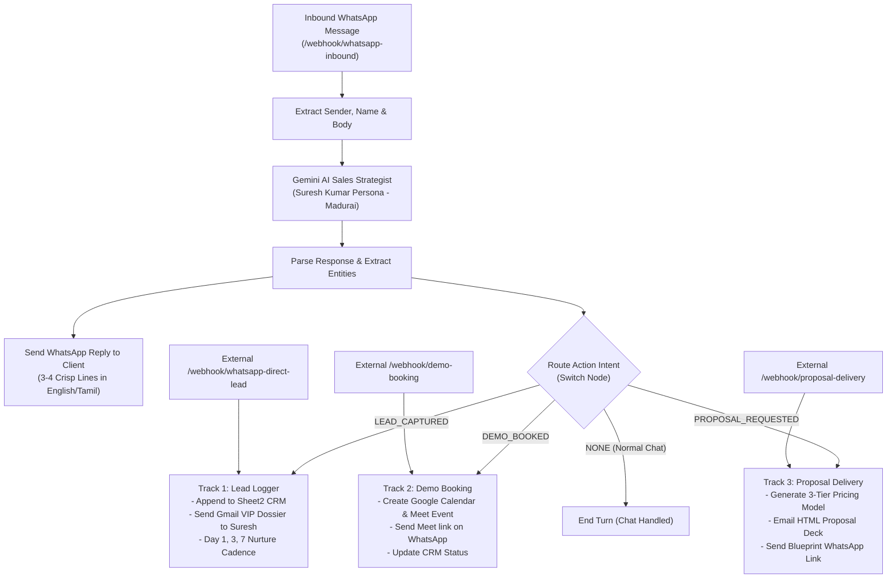

# 🚀 Unified Master WhatsApp AI Sales & CRM Automation Engine

## 📌 Overview
This workflow connects **Folder 2 (WhatsApp Live Chat & Gemini AI)** and **Folder 1 (Master Sales Engine & CRM)** into a single, cohesive **42-node autonomous system**.

It provides an end-to-end customer journey inside WhatsApp:
1. **Track 0:** Inbound WhatsApp Chat & Gemini AI Assistant (Answers customer messages, consults, and classifies intent)
2. **Track 1:** WhatsApp Lead Logger & CRM Nurture (Logs 36-41 fields to Google Sheet `Sheet2`, sends Gmail VIP dossier, stages automated follow-ups)
3. **Track 2:** Strategy Demo Booking & Calendar Dispatcher (Books Google Meet call, adds to Google Calendar, sends WhatsApp link)
4. **Track 3:** 3-Tier Grand Slam Proposal Delivery (Dispatches ₹9,999 / ₹19,999 / ₹34,999+ interactive HTML deck and WhatsApp blueprint)

---

## 🏗️ End-to-End System Flowchart

---

## 📁 Folder Contents
| File | Description |
| :--- | :--- |
| [`MASTER_SALES_ENGINE_WORKFLOW.json`](./MASTER_SALES_ENGINE_WORKFLOW.json) | **Unified 42-node master production workflow** combining Track 0 (Chat) + Tracks 1, 2, 3 (Sales Backend) |
| [`sheet2_columns_config.json`](./sheet2_columns_config.json) | Field schema mapping 36–41 CRM intelligence columns in Google Sheets (`Sheet2`) |
| [`sub_workflows/whatsapp_direct_lead_logger_workflow.json`](./sub_workflows/whatsapp_direct_lead_logger_workflow.json) | Standalone version of Track 1 (Lead Logger) |
| [`sub_workflows/demo_booking_workflow.json`](./sub_workflows/demo_booking_workflow.json) | Standalone version of Track 2 (Demo Booking) |
| [`sub_workflows/proposal_delivery_workflow.json`](./sub_workflows/proposal_delivery_workflow.json) | Standalone version of Track 3 (Proposal Delivery) |
| [`tests/test_28_lead_webhook.py`](./tests/test_28_lead_webhook.py) | Simulation script for lead capture |
| [`tests/test_demo_booking_webhook.py`](./tests/test_demo_booking_webhook.py) | Simulation script for demo booking |
| [`tests/test_proposal_webhook.py`](./tests/test_proposal_webhook.py) | Simulation script for proposal delivery |

---

## ⚙️ How the Connection Works
1. When a client texts on WhatsApp, it hits **`0. [Chat] Inbound WhatsApp Webhook`**.
2. **Gemini AI** converses with the user as Suresh Kumar's senior sales partner.
3. As soon as the customer provides their contact info and requirements, Gemini outputs:
   `action: "LEAD_CAPTURED"` ➔ The workflow automatically hands the data off to **Track 1**, writing 36 columns to Google Sheets and emailing Suresh!
4. If the client asks to book a demo:
   `action: "DEMO_BOOKED"` ➔ Automatically triggers **Track 2**, creating the Google Meet meeting and confirming it to the client!
5. If the client asks for a proposal:
   `action: "PROPOSAL_REQUESTED"` ➔ Automatically triggers **Track 3**, emailing them the 3-tier deck!
6. If called externally (e.g. from the Render Baileys bot), the dedicated webhook triggers for Tracks 1, 2, and 3 continue to work independently.
