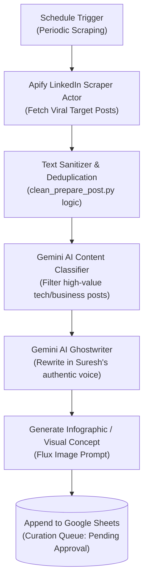

# 📢 LinkedIn Viral Post Generator & Content Engine

## 📌 Overview
The **LinkedIn Viral Post Generator** is an automated content curation and ghostwriting pipeline. It uses Apify to scrape viral, high-performing posts from top industry thought leaders on LinkedIn, filters and classifies them with Google Gemini AI, ghostwrites new original posts tailored to Suresh Kumar's voice, creates accompanying image generation prompts (Flux/SD), and stages them into Google Sheets for review.

---

## 📁 Folder Contents & Related Files
| File | Description |
| :--- | :--- |
| [`3_viral_linkedin_post_generator_workflow.json`](./3_viral_linkedin_post_generator_workflow.json) | Core automated post generation workflow |
| [`3_linkedin_content_parasite_FULL.json`](./3_linkedin_content_parasite_FULL.json) | Complete end-to-end scraper, rewriter, and image-prompt workflow (9 nodes) |
| [`3_linkedin_content_parasite_GEMINI.json`](./3_linkedin_content_parasite_GEMINI.json) | Optimized Gemini-powered content extraction & ghostwriting pipeline (11 nodes) |
| [`build_linkedin_workflow.py`](./build_linkedin_workflow.py) | Python build script to assemble and deploy the LinkedIn curation workflow |
| [`add_linkedin_workflow.py`](./add_linkedin_workflow.py) | Workflow registration helper script |
| [`clean_prepare_post.py`](./clean_prepare_post.py) | Utility to clean scraped LinkedIn text (strips emojis, cleans unicode, removes spam URLs) |
| [`fix_wf3.py`](./fix_wf3.py) | Node connection and payload patch script |
| [`update_image_gen_node.py`](./update_image_gen_node.py) | Configures AI image generation prompt nodes |
| [`update_infographic_image_prompt.py`](./update_infographic_image_prompt.py) | Customizes prompts for technical infographics |
| [`upgrade_content_and_image_quality.py`](./upgrade_content_and_image_quality.py) | Prompt optimization script for high-engagement LinkedIn posts |
| [`upgrade_prompt.py`](./upgrade_prompt.py) | System prompt refiner for tone consistency |
| [`inject_image_logic.py`](./inject_image_logic.py) | Injects dynamic image prompt generation logic |
| [`inject_video_logic.py`](./inject_video_logic.py) | Experimental video prompt logic |
| [`add_dynamic_image_prompt.py`](./add_dynamic_image_prompt.py) | Adds dynamic visual concept extraction |
| [`switch_to_flux.py`](./switch_to_flux.py) | Switches AI image model endpoint from default to Flux |

---

## 🏗️ Pipeline Architecture

---

## ⚙️ Key Workflow Stages
1. **Source Scraping:** Scrapes target creators via Apify LinkedIn Scraper Actor.
2. **Relevance Filtering:** Gemini filters out generic quotes, memes, and non-tech content.
3. **Ghostwriting:** Uses Hormozi hooks, 1-3 line crisp sentence structure, bulleted takeaways, and actionable software development tips.
4. **Visual Art Prompting:** Creates a structured image prompt suitable for Midjourney/Flux.
5. **Staging:** Appends `Post Text`, `Visual Prompt`, `Original Reference URL`, and `Status = Staged` to Google Sheets.
