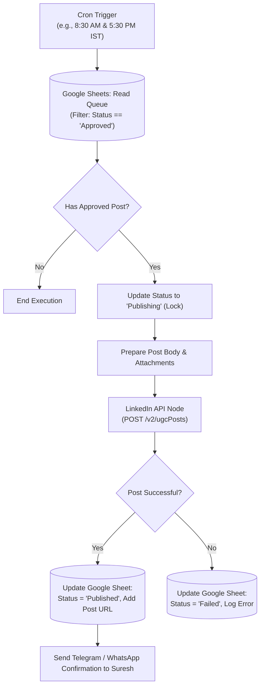

# ⏰ Scheduled LinkedIn Post Publisher Workflow

## 📌 Overview
The **Scheduled LinkedIn Post Publisher** is an autonomous publishing workflow (21 nodes). It monitors the approved content queue in Google Sheets on a fixed schedule (e.g., daily at optimal Indian business hours: 8:30 AM and 5:30 PM IST), claims the next approved post, formats it, publishes it via the LinkedIn API, and marks the record as published with the post URL.

---

## 📁 Folder Contents & Related Files
| File | Description |
| :--- | :--- |
| [`4_scheduled_linkedin_post_workflow.json`](./4_scheduled_linkedin_post_workflow.json) | The complete 21-node scheduled publishing pipeline definition |
| [`build_scheduled_linkedin.py`](./build_scheduled_linkedin.py) | Python build and deploy script for the scheduler workflow |
| [`fix_wf4_all_issues.py`](./fix_wf4_all_issues.py) | Fix script resolving node connections, OAuth token renewals, and status matching |

---

## 🏗️ Architecture & Execution Flow

---

## ⚙️ Key Specifications
* **Trigger:** Scheduled Cron node.
* **Sheet Integration:** Reads from `LinkedInContentQueue` sheet tab.
* **Concurrency Protection:** Implements status locking (`Status = 'Publishing'`) before triggering LinkedIn API to prevent duplicate post publication.
* **LinkedIn API Specs:** Uses LinkedIn OAuth2 credentials with `w_member_social` permissions.
