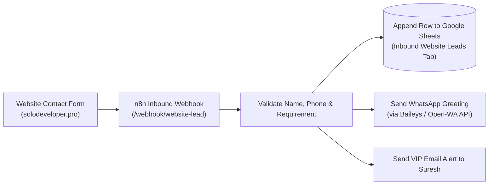

# 🌐 Website Lead Capture & Automated Greeting Workflow

## 📌 Overview
This workflow captures lead submissions originating from the contact forms and inquiry buttons on Suresh Kumar's portfolio website ([solodeveloper.pro](https://solodeveloper.pro)). Upon form submission, it immediately logs the inquiry into Google Sheets, sends an instant welcome message/greeting to the lead via WhatsApp, and fires an email notification to Suresh.

---

## 📁 Folder Contents & Related Files
| File | Description |
| :--- | :--- |
| [`4_website_lead_capture_workflow.json`](./4_website_lead_capture_workflow.json) | Webhook-driven website lead capture workflow (5 nodes) |
| [`contact_form_greeting_and_sheets_workflow.json`](./contact_form_greeting_and_sheets_workflow.json) | Complete form handler with email notification & WhatsApp greeting (7 nodes) |
| [`add_gmail_and_link.py`](./add_gmail_and_link.py) | Configuration script to wire Gmail node credentials and sheet links |

---

## 🏗️ Architecture & Lead Flow



---

## ⚙️ Inbound Webhook Payload Schema
```json
{
  "name": "Arun Kumar",
  "phone": "+919876543210",
  "email": "arun@example.com",
  "service": "3D Portfolio Website",
  "budget": "₹15,000",
  "message": "Looking for a fast portfolio site with smooth animations."
}
```

---

## 🚀 Key Actions Executed
1. **Validation:** Cleans phone number to international E.164 format (`91...`).
2. **CRM Log:** Records timestamp, lead details, and source `Website Inbound`.
3. **WhatsApp Auto-Greeting:** Delivers an instant personalized message:
   > *"Hello Arun! Thank you for reaching out through solodeveloper.pro. I have received your request regarding a 3D Portfolio Website and will review your requirements shortly. Suresh Kumar"*
4. **Owner Notification:** Dispatches instant Gmail alert to `sureshkumar20133151@gmail.com`.
