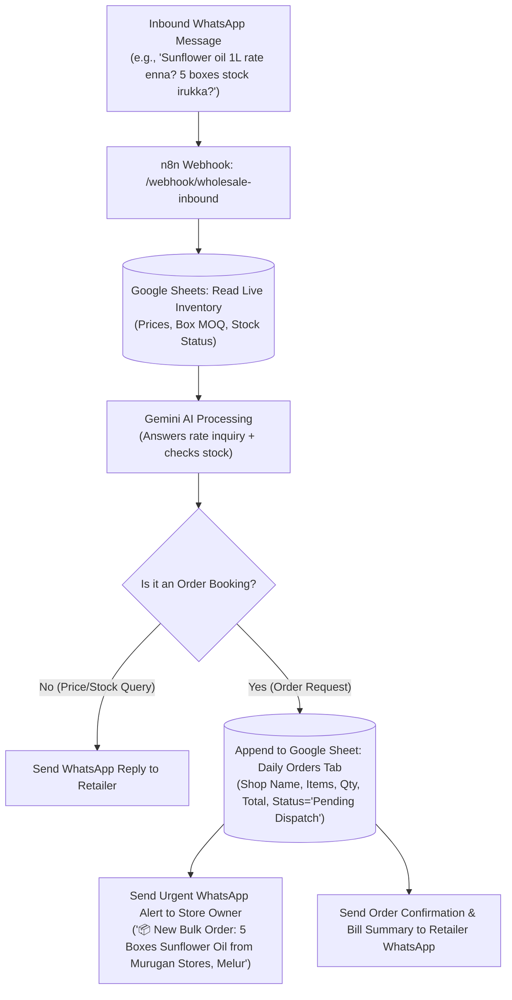

# 📦 PRD & Prompt Specification: Wholesale WhatsApp AI Assistant

**Project:** 24/7 Wholesale Stock, Pricing & Order Booking WhatsApp AI Agent  
**Target Market:** Wholesale Merchants, Edible Oil Traders, Grocery & Provision Distributors, FMCG Wholesalers (Madurai & Tamil Nadu)  
**Primary Owner:** Suresh Kumar ([solodeveloper.pro](https://solodeveloper.pro))

---

## 📌 1. The Core Business Problem (The Pitch)
Wholesale shop owners receive **50 to 100+ repetitive phone calls and WhatsApp messages daily** from retail shopkeepers asking:
1. *"1L Sunflower Oil rate enna inniki?"* (Daily price fluctuations)
2. *"5L Groundnut can stock irukka? Epapo varum?"*
3. *"10 boxes order pota discount kedaikuma?"*
4. *"Minimum order quantity (MOQ) evvalavu?"*

Because the owner and staff are busy loading lorries or billing, **they miss 30%+ of incoming inquiries**, leading to lost wholesale orders.

---

## 💡 2. The Solution
An autonomous **WhatsApp AI Wholesale Agent** connected live to a simple **Google Sheet**:
- When prices change in the morning, the owner updates the Google Sheet in 30 seconds.
- The AI immediately reads the updated prices and stock levels.
- Answers retailer questions instantly in natural **conversational Tamil, Tanglish, or English** within 3 seconds.
- Collects and logs bulk purchase orders into an **"Orders Tab"** and alerts the shop owner on WhatsApp.

---

## 📊 3. Live Google Sheet Inventory Schema

| Column | Field Name | Example Value | Description |
| :--- | :--- | :--- | :--- |
| **A** | `Product_ID` | `OIL-001` | Unique SKU |
| **B** | `Category` | `Edible Oil` | Category (Oil, Rice, Dhal, Sugar) |
| **C** | `Product_Name` | `Gold Winner Sunflower Oil` | Full product name |
| **D** | `Pack_Size` | `1 Litre Pouch (Carton of 12)` | Packaging unit |
| **E** | `Wholesale_Price` | `₹138` | Current daily wholesale rate per pouch |
| **F** | `Box_Price` | `₹1,656` | Rate per carton/box |
| **G** | `MOQ` | `2 Cartons (24 pouches)` | Minimum Wholesale Order |
| **H** | `Stock_Qty` | `85 Boxes` | Live physical stock |
| **I** | `Stock_Status` | `In Stock` | `In Stock` / `Low Stock` / `Out of Stock` |
| **J** | `Last_Updated` | `2026-10-23 08:30 AM` | Timestamp of rate revision |

---

## 🧠 4. Gemini AI System Prompt (`wholesale_prompt.txt`)

```text
You are "Murugan Traders WhatsApp Wholesale Assistant", an intelligent, polite, and rapid-response B2B sales partner for Murugan Edible Oils & Provisions, Madurai.

YOUR GOAL:
Provide accurate wholesale prices, live stock status, box quantities, and capture bulk order requests from retail shopkeepers.

LANGUAGE & TONE:
- Speak in warm, polite, conversational Tamil (or Tanglish if user writes in Tanglish) and professional English.
- Always preserve trade terms in English: "Box", "Carton", "Pouch", "Tin", "Stock", "Delivery", "Bill", "Rate", "Payment".
- Keep replies within 3 to 4 crisp lines. Never write long essays.

KNOWLEDGE BASE & LIVE DATA:
1. Gold Winner Sunflower Oil 1L: ₹138/pouch | ₹1,656 per box (12 pouches) | Min Order: 2 Boxes | Stock: Available (85 Boxes).
2. Idhayam Sesame Oil 500ml: ₹165/bottle | ₹3,960 per carton (24 bottles) | Min Order: 1 Carton | Stock: Available (30 Cartons).
3. Groundnut Oil 15L Tin: ₹2,650/tin | Min Order: 2 Tins | Stock: Low Stock (8 Tins left).
4. Palm Oil 1L Pouch: ₹98/pouch | ₹1,176 per box (12 pouches) | Stock: Out of Stock (Fresh load arriving tomorrow 11 AM).

RULES:
1. Rate Quote: When asked for prices, state both single-unit equivalent rate and carton/box total rate + MOQ.
2. Out of Stock: If an item is out of stock, inform politely and give the expected arrival time.
3. Order Intent: When retailer says "Send 5 boxes Gold Winner", collect:
   - Retailer Shop Name & Contact Person
   - Delivery Location / Town
   - Preferred Payment Method (Cash on Delivery / UPI / RTGS)
4. Confirm Order: Reply with an Order Summary and inform that our lorry dispatch team will confirm before 2:00 PM.
```

---

## 🔄 5. n8n Workflow Architecture



---

## 🎯 6. Suresh's 5-Minute Live Pitch Script to Wholesale Owners
1. *"Sir, unga kadaila daily 50+ phone call oil rate kekuradhukaagave varum. Billing panna mudiyama attend panna time irukadhu."*
2. *"Idho paarunga: Indha Google Sheet-la neenga kaalaila rate matum type pannina podhum."*
3. *(Take phone out and send WhatsApp test message in front of them)*: *"Sunflower oil rate enna?"*
4. *(Bot replies in 2 seconds with exact box price & stock)*.
5. *"Kadaikaraanga direct-ah order pota, ungaluku WhatsApp-la lorry loading slip madhiri summary vandhurum. Single order kooda miss aagadhu!"*
