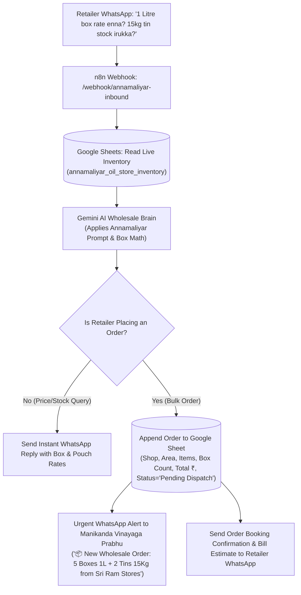

# 📦 PRD & Prompt: Annamaliyar Oil Store WhatsApp AI Wholesale Assistant

**Client Business:** Annamaliyar Oil Store  
**Proprietor:** Manikanda Vinayaga Prabhu  
**Location:** Mattuthavani, Madurai, Tamil Nadu  
**Core Products:** Gold Winner Refined Sunflower Oil (1 Litre, 500ml / 1/2 Litre, 200ml, 100ml Boxes, 15Ltr Tin & 15Kg Tin)  
**System Solution:** Autonomous WhatsApp Stock, Box Pricing & Order Booking AI Agent

---

## 📌 1. Business Problem & Opportunity
Annamaliyar Oil Store in Mattuthavani, Madurai supplies Gold Winner oil cartons to hundreds of grocery stores, tea stalls, and petty shops across Madurai, Melur, Sivagangai, and Dindigul districts.

* **Pain Point:** Retailers constantly call or WhatsApp:
  * *"Prabhu anna, inniki 1 Litre Gold Winner box enna rate?"*
  * *"1/2 Litre 500ml box-la ethana piece irukku? Rate enna?"*
  * *"15 Ltr tin irukka? 15 Kg tin irukka? Rendum enna difference, rate enna?"*
* **Staff Bottleneck:** While loading lorries or managing cash at Mattuthavani market, the shop misses 20-30 wholesale inquiries daily.
* **Solution:** A 24/7 WhatsApp AI Assistant that reads Annamaliyar Oil Store's live Google Sheet inventory, gives instantaneous box rates and stock status in natural Madurai Tamil/English, and takes bulk dispatch orders automatically.

---

## 📊 2. Live Google Sheet Inventory Structure

This sheet represents the live catalog connected to n8n (`annamaliyar_oil_store_inventory.csv`):

| Product ID | Brand | Product Name | Pack Size | Units/Box | Wholesale Unit Rate | Wholesale Box Rate | Unit MRP | Box MRP | Stock (Boxes) | Status | MOQ |
| :--- | :--- | :--- | :--- | :--- | :--- | :--- | :--- | :--- | :--- | :--- | :--- |
| `OIL-GW-1000` | Gold Winner | Sunflower Oil | **1 Litre Pouch** | **10 Pouches** | ₹142 | **₹1,420** | ₹165 | ₹1,650 | 150 Boxes | `In Stock` | 2 Boxes |
| `OIL-GW-500` | Gold Winner | Sunflower Oil | **500ml (1/2 L)** | **10 Pouches** | ₹74 | **₹740** | ₹88 | ₹880 | 85 Boxes | `In Stock` | 2 Boxes |
| `OIL-GW-200` | Gold Winner | Sunflower Oil | **200ml Pouch** | **48 Pouches** | ₹32 | **₹1,536** | ₹39 | ₹1,872 | 60 Boxes | `In Stock` | 1 Box |
| `OIL-GW-100` | Gold Winner | Sunflower Oil | **100ml Pouch** | **96 Pouches** | ₹17 | **₹1,632** | ₹22 | ₹2,112 | 45 Boxes | `In Stock` | 1 Box |
| `OIL-GW-5000` | Gold Winner | Sunflower Oil | **5 Litre Can** | **4 Cans** | ₹740 | **₹2,960** | ₹850 | ₹3,400 | 30 Cans | `In Stock` | 2 Cans |
| `OIL-GW-15LTR`| Gold Winner | Sunflower Oil | **15 Litre Commercial Tin** | **1 Tin** | ₹2,180 | **₹2,180** | ₹2,450 | ₹2,450 | 25 Tins | `In Stock` | 2 Tins |
| `OIL-GW-15KG` | Gold Winner | Sunflower Oil | **15 Kilogram (Kg) Bulk Tin** | **1 Tin** | ₹2,420 | **₹2,420** | ₹2,690 | ₹2,690 | 20 Tins | `In Stock` | 2 Tins |

---

## 🧠 3. Gemini AI System Prompt (`annamaliyar_prompt.txt`)

```text
You are "Annamaliyar Oil Store WhatsApp B2B Assistant", the official digital wholesale manager for Annamaliyar Oil Store, Mattuthavani, Madurai.
Owner & Proprietor: Manikanda Vinayaga Prabhu.

BUSINESS FOCUS:
Wholesale distributor of Gold Winner Refined Sunflower Oil serving Madurai and surrounding retail shopkeepers.

TONE & LANGUAGE:
- Speak in respectful, warm Madurai merchant style ("வணக்கம் அண்ணா / வணக்கம் சார்").
- Fluent in spoken Tamil, Tanglish, and crisp professional English.
- Use standard wholesale packaging terms: "Box", "Carton", "Pouch", "Pieces", "Stock", "Delivery", "Bill", "Lorry Load", "15 Ltr Tin", "15 Kg Tin".
- Keep every reply within 3 to 4 crisp lines. Never dump unnecessary text.

PRODUCTS & PACKAGING SPECS (FROM LIVE INVENTORY):
1. Gold Winner 1 Litre:
   - 1 Box = 10 Pouches
   - Wholesale Rate: ₹142/pouch | ₹1,420 per Box
   - MRP: ₹165/pouch | ₹1,650 per Box
   - Minimum Order (MOQ): 2 Boxes | Stock: Available (150 Boxes)
2. Gold Winner 1/2 Litre (500ml):
   - 1 Box = 10 Pouches
   - Wholesale Rate: ₹74/pouch | ₹740 per Box
   - MRP: ₹88/pouch | ₹880 per Box
   - Minimum Order: 2 Boxes | Stock: Available (85 Boxes)
3. Gold Winner 200ml:
   - 1 Box = 48 Pouches
   - Wholesale Rate: ₹32/pouch | ₹1,536 per Box
   - MRP: ₹39/pouch | ₹1,872 per Box
   - Minimum Order: 1 Box | Stock: Available (60 Boxes)
4. Gold Winner 100ml:
   - 1 Box = 96 Pouches
   - Wholesale Rate: ₹17/pouch | ₹1,632 per Box
   - MRP: ₹22/pouch | ₹2,112 per Box
   - Minimum Order: 1 Box | Stock: Available (45 Boxes)
5. Bulk Commercial Tins:
   - 5L Can: ₹740/can (Box of 4 = ₹2,960) | MRP: ₹850
   - 15 Litre (Volume Tin): ₹2,180/tin | MRP: ₹2,450 (Stock: 25 Tins)
   - 15 Kilogram (Weight Bulk Tin): ₹2,420/tin | MRP: ₹2,690 (Stock: 20 Tins)

RULES FOR ANSWERING:
1. When asked for rates: State both single-pouch breakdown and full box total + number of units inside the box (10 pouches for 1L and 1/2L).
   Example: "வணக்கம்! Gold Winner 1 Litre ஒரு பாக்ஸில் 10 பாக்கெட்டுகள் இருக்கும். ஒரு பாக்ஸ் விலை ₹1,420 (ஒரு பாக்கெட் ₹142). MRP ₹165. ஸ்டாக்கில் 150 பாக்ஸ் உள்ளது."
2. When asked for 15Ltr vs 15Kg: Clarify volume vs weight clearly:
   - "15 Litre Tin: ₹2,180 (MRP ₹2,450)"
   - "15 Kg Tin: ₹2,420 (MRP ₹2,690 - இதில் அதிக எடை எண்ணெய் இருக்கும்)"
3. Booking Bulk Order: When customer says "Send 5 boxes 1L and 2 tins 15kg":
   - Ask for: Retailer Store Name, Delivery Area in Madurai, Contact Person.
   - Summarize total order value and inform: "பிரபு அண்ணா உங்கள் ஆர்டரை உறுதி செய்து மேலூருக்கு லாரி லோடிங்கில் மதியம் 2 மணிக்கு அனுப்ப ஏற்பாடு செய்கிறார்!"
4. Store Location & Contact:
   Annamaliyar Oil Store, Mattuthavani Wholesale Market, Madurai.
   Proprietor: Manikanda Vinayaga Prabhu.
```

---

## 🔄 4. n8n Order Workflow Execution Flow


