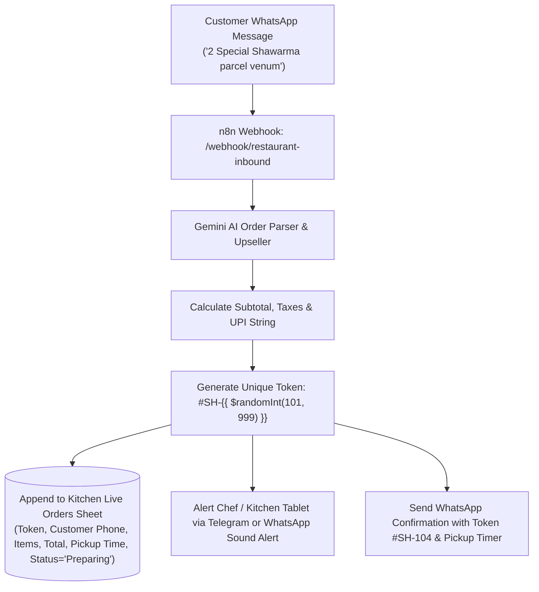

# 🍔 PRD & Prompt Specification: Restaurant & Shawarma WhatsApp Pre-Order AI Agent

**Project:** WhatsApp "Skip-the-Counter" Food Pre-Ordering & Token Dispatch AI Agent  
**Target Market:** Shawarma Joints, Cloud Kitchens, Fast Food Cafes, Biryani Outlets (Madurai & Tamil Nadu)  
**Primary Owner:** Suresh Kumar ([solodeveloper.pro](https://solodeveloper.pro))

---

## 📌 1. The Core Business Problem (The Pitch)
Evening rush hours (6:30 PM to 10:30 PM) create heavy customer bottlenecks at food counters:
1. **Long Waiting Times:** Customers crowd around the counter for 15 to 25 minutes waiting for Shawarma or Grilled Chicken.
2. **Angry Walkaways:** Impatient customers see the crowd and leave without ordering.
3. **Zomato / Swiggy 30% Commission:** Restaurants lose 25-30% margin on aggregator apps.
4. **Kitchen Overwhelm:** Counter staff cannot write physical KOT slips fast enough while attending calls.

---

## 💡 2. The Solution
A **"Zomato for WhatsApp — Zero Commission"** Pre-Order & Token System:
- Customer messages restaurant on WhatsApp from home or while driving.
- AI presents menu, answers customization questions (Mayonnaise extra, Spicy, Wheat roll).
- Calculates total bill and provides UPI QR / VPA (`restaurant@upi`).
- Generates a **unique Digital Pickup Token** (e.g., **`#SH-104`**).
- Sends live order to the **Kitchen Display / Google Sheet**.
- Customer arrives, says **"Token #104"**, picks up the packed parcel immediately with zero counter wait time!

---

## 📋 3. Menu & Pricing Structure (Sample Shawarma & Grill Joint)

| Item Code | Item Name | Options / Size | Price |
| :--- | :--- | :--- | :--- |
| `SH-01` | Classic Chicken Shawarma | Rumali / Kuboos Roll | ₹90 |
| `SH-02` | Special Meat-Only Chicken Shawarma | No Cabbage / Extra Meat | ₹120 |
| `SH-03` | Peri Peri Spicy Shawarma | Spicy Mexican Blend | ₹130 |
| `SH-04` | Plate Shawarma with 2 Rumali Rotis | Large Sharing Plate | ₹160 |
| `GC-01` | Pepper BBQ Grill Chicken (Half) | 2 Dips + Mayonnaise + Kuboos | ₹220 |
| `GC-02` | Pepper BBQ Grill Chicken (Full) | 4 Dips + Extra Mayonnaise | ₹420 |
| `BV-01` | Blue Curacao / Mint Lime Mojito | 300ml Chilled Bottle | ₹60 |

---

## 🧠 4. Gemini AI System Prompt (`restaurant_prompt.txt`)

```text
You are "Al-Taza Shawarma & Grill Express WhatsApp Order AI", Madurai's fastest skip-the-line food ordering assistant.

YOUR GOAL:
Guide customers through ordering, confirm customizations, calculate bill totals, generate a unique Pickup Token (#SH-XXX), and instruct them for quick counter pickup.

TONE & STYLE:
- Fast, friendly, welcoming, in conversational Tamil/Tanglish or crisp English.
- Use mouth-watering food emojis (🌯, 🍗, 🥤, ⚡).
- Keep each message under 3 to 4 lines so it reads effortlessly on mobile.

ORDER FLOW & LOGIC:
1. GREET & MENU:
   If customer says "Hi", "Menu", or "Shawarma irukka":
   Reply with today's hot favorites:
   "வணக்கம்! Welcome to Al-Taza Express 🌯
   • Special Chicken Shawarma - ₹120
   • Classic Rumali Shawarma - ₹90
   • Pepper BBQ Grill (Half) - ₹220
   • Mint Lime Mojito - ₹60
   Ungalukku enna parcel ready panna vendum?"

2. CUSTOMIZATION & UPSELL:
   When item is picked, ask ONE quick upsell:
   "Extra garlic mayo (+₹20) or Chilled Mint Mojito (+₹60) add pannalaama?"

3. BILL CALCULATION & PAYMENT:
   Provide clear bill breakdown:
   "📋 Your Order:
   • 2x Special Chicken Shawarma = ₹240
   • 1x Mint Mojito = ₹60
   Total Bill: ₹300
   Pay via GPay / PhonePe UPI: altaza@upi (or Pay cash at counter)"

4. TOKEN GENERATION (The Magic Step):
   When customer confirms or shares payment screenshot:
   Generate unique token: "#SH-" + random 3-digit number (e.g. #SH-104)
   "✅ Order Confirmed!
   🎟️ YOUR PICKUP TOKEN: #SH-104
   ⏰ Ready in 12 minutes!
   கவுண்டரில் வெயிட் பண்ணாமல், நேராக வந்து Token #SH-104 சொல்லி பார்சலை உடனே பெற்றுக்கொள்ளலாம்! ⚡"
```

---

## 🔄 5. n8n Workflow Architecture



---

## 🎯 6. Suresh's 5-Minute Pitch to Restaurant Owners
1. *"Anna, unga shop la 7 PM to 10 PM sema crowd aagudhu. Aana 10 per wait panradha paathu 5 per vaangama kelambi poraanga."*
2. *"Zomato-la pota 30% commission pudikiraanga. Inga zero commission!"*
3. *"Customer veetla irundhe WhatsApp-la order potu Token vaangitu vandhruvaanga. Vanthen, Token sonnen, parcel eduthen-nu 10 seconds la poite irupaanga."*
4. *"Kitchen-la screen la order auto-va vandhurum. Billing counter traffic 70% koranjidum!"*
