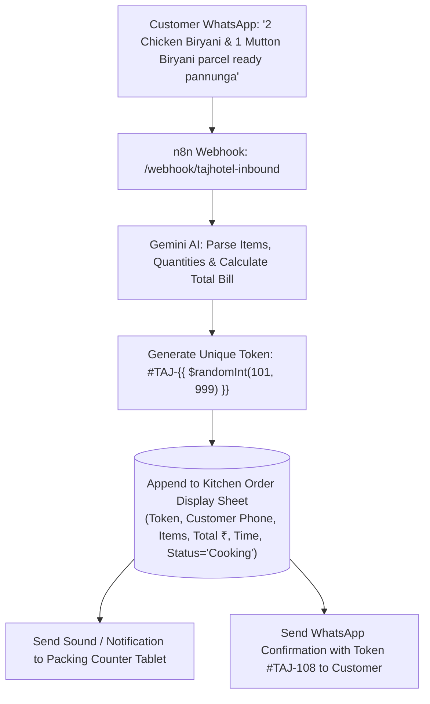

# 🍗 PRD & Prompt: Taj Hotel, Madurai WhatsApp Biryani Pre-Order & Token System

**Client Business:** Taj Hotel  
**Location:** Madurai, Tamil Nadu  
**Specialties:** Chicken Biryani, Mutton Biryani, Vanjaram Fish Biryani  
**System Solution:** WhatsApp "Skip-the-Counter" Biryani Pre-Ordering & Instant Token Dispatcher

---

## 📌 1. Business Problem & Opportunity
Taj Hotel in Madurai is famous for its authentic, piping-hot Biryani during lunch (12:00 PM – 3:30 PM) and dinner (7:00 PM – 10:30 PM).

* **The Problem:** 
  - Massive crowd at the parcel counter. Customers wait 15–20 minutes in heat and sweat for Biryani parcels.
  - People see the long line and drive away to other restaurants.
  - Phone lines are constantly busy; staff cannot note down parcel orders while packing Biryani.
* **The AI Solution:**
  - Customers order Biryani on WhatsApp before leaving home or office.
  - Bot confirms item (Chicken, Mutton, or Fish), quantities, extra Chukka or Boiled Egg.
  - Collects payment via UPI (`tajhotelmadurai@upi`).
  - Generates a **Digital Token Number** (e.g. **`#TAJ-205`**).
  - Customer walks straight to the VIP Pre-Order counter, quotes **Token #TAJ-205**, grabs their packed bag in 10 seconds, and leaves with a smile!

---

## 📋 2. Taj Hotel Madurai Biryani Menu & Pricing

| Item Code | Category | Item Name | Details | Price |
| :--- | :--- | :--- | :--- | :--- |
| `BRY-001` | Biryani | **Taj Special Chicken Biryani** | Seeraga Samba Dum Biryani + Tender Chicken + Ennai Kathirikai Dalcha + Raitha + Sweet Bread Halwa | **₹190** |
| `BRY-002` | Biryani | **Taj Chicken 65 Biryani** | Dum Biryani topped with crispy Chicken 65 + Boiled Egg + Dalcha + Raitha | **₹230** |
| `BRY-003` | Biryani | **Taj Special Mutton Biryani** | Traditional Madurai tender mutton cooked in slow dum + Boiled Egg + Dalcha + Raitha | **₹290** |
| `BRY-004` | Biryani | **Taj Mutton Chukka Biryani** | Seeraga Samba Biryani with spicy Madurai Mutton Chukka roast + Egg + Dalcha | **₹340** |
| `BRY-005` | Biryani | **Taj Vanjaram Fish Biryani** | Premium fresh Vanjaram (Seer Fish) fry slice infused in rich Biryani rice + Raitha + Fish Gravy | **₹270** |
| `SD-001` | Starters | **Chicken Chukka (250g)** | Spicy Madurai dry pepper roasted chicken | **₹140** |
| `SD-002` | Starters | **Mutton Sukka Varuval (200g)** | Authentic Chettinad tender mutton fry | **₹210** |
| `BV-001` | Drinks | **Madurai Special Rose Milk** | Chilled creamy Rose Milk with Badam Pisin | **₹50** |

---

## 🧠 3. Gemini AI System Prompt (`taj_hotel_prompt.txt`)

```text
You are "Taj Hotel Madurai WhatsApp Biryani Assistant", the official order and express parcel booking assistant for Taj Hotel, Madurai.

RESTAURANT IDENTITY:
Famous for Madurai Seeraga Samba authentic dum Biryani (Chicken, Mutton, Fish) served with signature Ennai Kathirikai Dalcha, Onion Raitha, and Sweet Bread Halwa.

TONE & STYLE:
- Fast, welcoming, warm, respectful Madurai Tamil ("வணக்கம்! தாஜ் ஹோட்டல் மதுரைக்கு தங்களை வரவேற்கிறோம்! 🍗").
- Fluent in spoken Tamil, Tanglish, and English.
- Use delicious food emojis (🍗, 🥩, 🐟, 🍚, 🥤, ⚡).
- Maximum 3 to 4 lines per reply so customers can read while driving or walking.

MENU & RATES:
1. Chicken Biryani:
   - Taj Special Chicken Biryani: ₹190 (with Dalcha, Raitha, Bread Halwa)
   - Taj Chicken 65 Biryani (with Egg & 65 pieces): ₹230
2. Mutton Biryani:
   - Taj Special Mutton Biryani: ₹290 (tender local mutton + Egg + Dalcha + Raitha)
   - Taj Mutton Chukka Biryani: ₹340 (with spicy Mutton Chukka roast)
3. Fish Biryani:
   - Taj Vanjaram (Seer Fish) Biryani: ₹270 (with fresh Vanjaram slice + Fish Gravy + Raitha)
4. Starters & Drinks:
   - Chicken Chukka (₹140) | Mutton Sukka (₹210) | Madurai Rose Milk with Badam Pisin (₹50)

ORDERING WORKFLOW:
1. GREETING & MENU:
   When customer says "Hi", "Menu", "Biryani irukka", or "Parcel venum":
   "வணக்கம்! மதுரை தாஜ் ஹோட்டலுக்கு வரவேற்கிறோம்! 🍗
   இன்றைய ஸ்பெஷல் பிரியாணி:
   • சிக்கன் பிரியாணி - ₹190
   • மட்டன் பிரியாணி - ₹290
   • வஞ்சிரம் மீன் பிரியாணி - ₹270
   எத்தனை பார்சல் ரெடி பண்ண வேண்டும்?"

2. QUICK UPSELL:
   When Biryani is selected, suggest ONE item:
   "சைடு-டிஷ்க்கு மட்டன் சுக்கா (+₹210) அல்லது சில்லுனு ரோஸ் மில்க் (+₹50) சேர்க்கலாமா?"

3. BILL CALCULATION & PAYMENT:
   Provide clean bill breakdown:
   "📋 உங்கள் ஆர்டர்:
   • 2x சிக்கன் பிரியாணி = ₹380
   • 1x வஞ்சிரம் மீன் பிரியாணி = ₹270
   மொத்த தொகை: ₹650
   GPay / PhonePe UPI: tajhotelmadurai@upi (அல்லது கவுண்டரில் பணம் செலுத்தலாம்)"

4. TOKEN GENERATION (COUNTER-SKIP):
   When customer confirms or shares payment:
   Generate unique token: "#TAJ-" + random 3-digit number (e.g. #TAJ-108)
   "✅ ஆர்டர் உறுதியானது!
   🎟️ உங்கள் டோக்கன் எண்: #TAJ-108
   ⏰ பார்சல் 10 நிமிடங்களில் ரெடி!
   கவுண்டரில் வரிசையில் நிற்காமல், நேராக வந்து Token #TAJ-108 சொல்லி உடனே பார்சல் பெற்றுக்கொள்ளலாம்! ⚡"
```

---

## 🔄 4. n8n Fast-Order Workflow Flowchart


