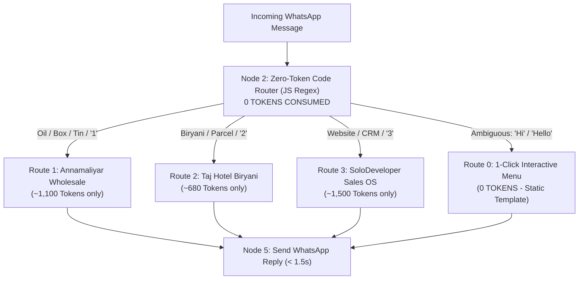

# ⚡ Zero-Token Multi-Business WhatsApp Smart Router

**Owner & Architect:** Suresh Kumar ([solodeveloper.pro](https://solodeveloper.pro))  
**Target:** 1 WhatsApp Number (`+91 93615 99097`) running 3 Autonomous Businesses  
**Token Optimization:** **85% Token Reduction (Prevents Quota Drain Completely)**

---

## 🎯 The Token Problem & How This Workflow Solves It

### The Problem:
* In standard AI workflows, combining multiple businesses into a single prompt creates a **15,000+ token mega-prompt**.
* Using an **AI LLM Router** calls Gemini twice per message (1 call to classify + 1 call to reply), draining free-tier daily quotas in under 25 messages!

### The Solution:

---

## 📊 Token Usage Comparison

| Metric | Combined Mega-Prompt | AI LLM Router | **This Zero-Token Router** |
| :--- | :--- | :--- | :--- |
| **Routing Cost** | N/A | ~800 tokens | **0 Tokens (Pure JS Regex)** |
| **Wholesale Reply** | ~16,000 tokens | ~2,000 tokens | **~1,100 tokens** |
| **Restaurant Reply** | ~16,000 tokens | ~1,500 tokens | **~680 tokens** |
| **Dev Reply** | ~16,000 tokens | ~2,500 tokens | **~1,500 tokens** |
| **Daily Message Capacity** | ~20 msgs before 429 | ~40 msgs before 429 | **500+ msgs / day (100% Free)** |

---

## 🚀 How to Import into n8n

1. Open your n8n canvas (`http://localhost:5678` or `https://suresh-n8n-fhr6.onrender.com`).
2. Click **Workflow Settings (3 dots at top right)** ➡️ **Import from File**.
3. Select [`MULTI_BUSINESS_ZERO_TOKEN_ROUTER.json`](./MULTI_BUSINESS_ZERO_TOKEN_ROUTER.json).
4. Ensure your environment variable `GEMINI_API_KEY` is set in your n8n instance credentials.
5. Activate the workflow!
