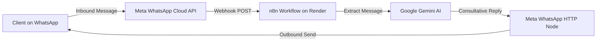

# 🚀 SoloDeveloper - Official Meta WhatsApp AI Agent

This system provides a dedicated, autonomous WhatsApp AI Agent for **Suresh Kumar — SoloDeveloper ([solodeveloper.pro](https://solodeveloper.pro))**, powered exclusively by the **official Meta WhatsApp Cloud API** and **Google Gemini AI**.

> [!IMPORTANT]
> **Persona Isolation:**
> - **SoloDeveloper Agent:** Runs 100% on Meta WhatsApp Cloud API (`v21.0`).
> - **Wholesale & Restaurant Agents:** Remain completely on their existing Baileys/Render infrastructure.

---

## 🏗️ Architecture

---

## 📁 Key Files & Workflow

| File | Purpose |
| :--- | :--- |
| **`SOLODEV_META_WHATSAPP_AI_AGENT.json`** | Complete n8n workflow for inbound/outbound SoloDeveloper WhatsApp AI conversations. |
| **`project/04_website_lead_capture/contact_form_greeting_and_sheets_workflow.json`** | Updated to send instant WhatsApp greetings to website leads directly via Meta Cloud API. |
| **`.env`** & **`meta_whatsapp_credentials.json`** | Local credentials store (ignored by Git). |

---

## ⚙️ Meta Webhook Configuration in Meta Dashboard

To connect your Render n8n instance to Meta:

1. In your Meta App Dashboard (**Outreach agent**), go to **WhatsApp** > **Configuration** on the left menu.
2. Under **Webhook**, click **Edit**:
   * **Callback URL:** `https://suresh-n8n-fhr6.onrender.com/webhook/solodev-meta-webhook`
   * **Verify Token:** `solodev_meta_2026`
3. Click **Verify and Save**.
4. Under **Webhook fields**, click **Manage** and subscribe to:
   * ✅ `messages`
