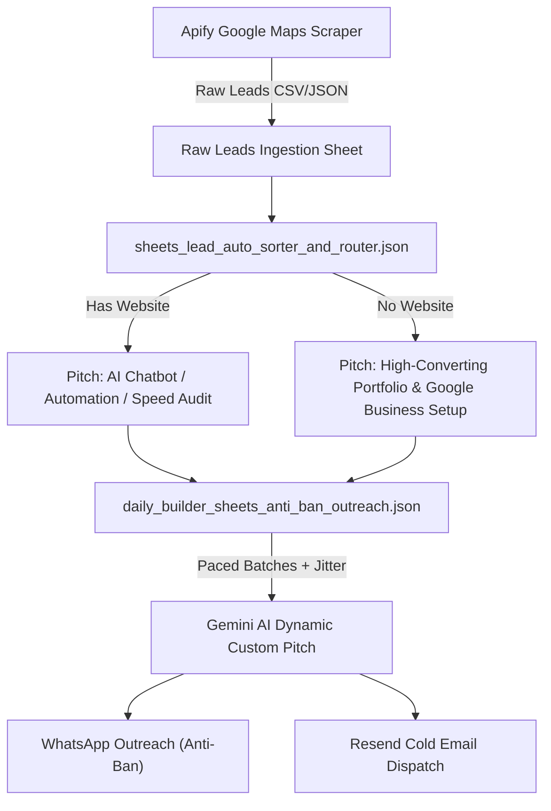

# 🎯 Project 11: Lead Generation, Auto-Sorting & Anti-Ban Cold Outreach Engine

**System Role:** Autonomous B2B Lead Scraping, Segmentation, and Multi-Channel Cold Outreach  
**Channels:** Apify (Google Maps Scraper), Google Sheets CRM, Gemini AI Ghostwriter, WhatsApp API, Resend (Email)  
**System Status:** 🟢 Production Ready

---

## 📌 Overview

This project provides an end-to-end client acquisition and cold outreach infrastructure. It automates the entire funnel: extracting prospective B2B clients (e.g. builders, contractors, retail businesses) from Google Maps, classifying and sorting them based on digital presence (website vs. no website), generating highly personalized outreach copy via Gemini AI, and dispatching multi-touch campaigns via email (Resend) and WhatsApp with strict anti-ban pacing algorithms.

---

## 🏗️ Architecture Pipeline

---

## 📂 Included Workflow Files

| File | Primary Role | Description |
| :--- | :--- | :--- |
| **[`apify_builder_cold_outreach_engine.json`](./apify_builder_cold_outreach_engine.json)** | Lead Scraper & Enricher | Scrapes targeted local businesses via Apify Google Maps actor, cleans contact numbers, extracts emails, and stages raw records into Google Sheets. |
| **[`sheets_lead_auto_sorter_and_router.json`](./sheets_lead_auto_sorter_and_router.json)** | Lead Classifier & Router | Automatically routes raw leads into dedicated sheet tabs: `With_Website` (targeting automation/AI bots) vs `Without_Website` (targeting web development). |
| **[`daily_builder_sheets_anti_ban_outreach.json`](./daily_builder_sheets_anti_ban_outreach.json)** | Paced Multi-Touch Outreach | Pulls daily quota from Google Sheets, applies randomized pacing delays (30–90 seconds) to avoid WhatsApp rate-limits/bans, and triggers AI outreach. |
| **[`cold_outreach_resend_workflow.json`](./cold_outreach_resend_workflow.json)** | Cold Email Dispatcher | Lightweight Resend API integration for high-deliverability cold email delivery and open/bounce tracking. |
| **[`production_outreach_google_sheets_workflow.json`](./production_outreach_google_sheets_workflow.json)** | Full AI Cold Email Engine | End-to-end production workflow that pairs Google Sheets leads with Gemini personalized email copy generation and dispatches via Resend. |

---

## 🛡️ Anti-Ban Safeguards & Best Practices

1. **Volume Capping:** Maximum 15–25 WhatsApp outreach messages per day per number.
2. **Dynamic Jitter:** Sleep delays between requests vary randomly between 45s and 120s.
3. **Personalized Spintax / LLM Variations:** Every outgoing message is rephrased by Gemini so no two prospects receive identical hash signatures.
4. **Instant Opt-Out:** Clear STOP/unsubscribe mechanism respects recipient preference instantly.
