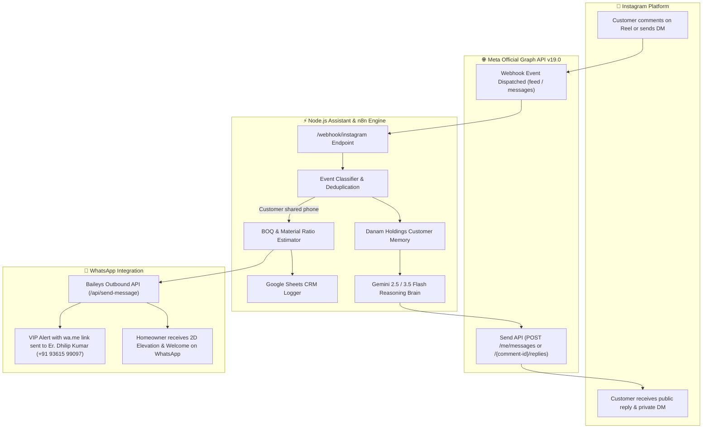

# 📸 Project 12: Instagram AI Agent & Reel Comment-to-DM Automation

**Client Persona:** Danam Holdings Civil Engineering & Turnkey EPC (Er. Dhilip Kumar)  
**Location:** Madurai, Tamil Nadu, India  
**System Status:** 🟢 Production Ready (Standalone n8n Workflow & Node.js Baileys Integrated)  
**Operating Cost:** ₹0 (100% Free Tier Architecture)

---

## 📌 1. Overview & Business Impact

For visual businesses like **House Construction, Civil EPC (Danam Holdings)**, Architecture, and Real Estate, **Instagram is the #1 organic lead generation channel**.

Homeowners discover 3D elevations, structural videos, and site walkthrough reels on Instagram. However, **over 90% of prospective buyers drop off** when their comments or direct messages are not answered within 5 minutes.

This project delivers an **Autonomous Instagram AI Agent** that works 24/7 to:
1. **Instantly reply to Reel & Post comments** in public.
2. **Automatically trigger a private Direct Message (DM)** to every commenter with Turnkey Package pricing.
3. **Conduct deep civil engineering consultations** in respectful Tamil by default (Corner vs Middle plot, Setbacks, OTS duct, Madurai landmarks).
4. **Capture the homeowner's WhatsApp phone number** and automatically bridge them into WhatsApp with instant 2D elevations, BOQ estimates, and Chief Engineer alerts.

```
Instagram Reel View ➔ Comment ("Price / Plan?") ➔ Auto Public Reply ➔ Private DM by AI ➔ Qualification & Phone Capture ➔ WhatsApp Handover ➔ Closed Deal
```

---

## 🏗️ 2. System Architecture & Flow



---

## 🚀 3. Core Features

### Feature A: Reel & Post Comment-to-DM Auto-Reply
* **Trigger:** Customer comments on any Reel or Post (e.g. *"Price?"*, *"Villapuram site"*, *"Square feet rate?"*).
* **Action 1 (Public Comment Reply):** Rotates friendly, professional Tamil replies:
  * *"நன்றி சார்! உங்கள் DM-ல் முழு விபரங்களை அனுப்பியுள்ளோம், தயவுசெய்து செக் செய்யவும் 📩"*
  * *"வணக்கம் சார்! இந்த எலிவேஷன் மற்றும் பிளான் விபரங்களை உங்கள் DM-க்கு அனுப்பியுள்ளோம் 🙏"*
  * *"நன்றி! Danam Holdings சார்பாக உங்கள் DM-ல் முழு விபரங்களைப் பகிர்ந்துள்ளோம் 🏡"*
* **Action 2 (Instant Private DM):** Sends a direct message with standard Turnkey package rates (`₹1,850 - ₹1,950` Standard, `₹2,250 - ₹2,350` Premium) and discovers plot size and location.

### Feature B: 24/7 AI Direct Message (DM) Assistant
* **Language Rules:** Respectful Tamil script by default (e.g. *"வணக்கம் சார்!"*).
* **Civil Engineering Loanwords:** Keeps measurement and engineering terms in English (`Sq.Ft`, `cents`, `Plot`, `Corner Plot`, `Middle Plot`, `Setback`, `OTS Duct`, `G+1 Duplex`).
* **Madurai Real-Proof Validation:** Immediate landmark checks (Villapuram -> Vetri Theater, Goripalayam -> Thevar Silai, Mattuthavani -> Flower Market / Apollo).
* **Civil Consultation:** Inquires about setback regulations, drainage slope, and room configurations.

### Feature C: Instagram-to-WhatsApp Funnel Bridge
* Scans incoming messages for 10-digit mobile numbers.
* Automatically writes the enquiry to `data/construction_enquiries.json` and Google Sheets.
* Computes instant rule-of-thumb civil material ratios:
  - **Cement:** ~0.42 bags / sq.ft
  - **TMT Steel (Fe550D):** ~3.8 kg / sq.ft
  - **Bricks / Solid Blocks:** ~18 units / sq.ft
* Dispatches a personalized WhatsApp greeting to the homeowner and a VIP notification to Chief Engineer **Er. Dhilip Kumar (`+91 93615 99097`)**.

---

## 💰 4. Pricing & 100% Free Tier Compliance

| Component | Provider | Free Tier Limit | Monthly Cost |
| :--- | :--- | :--- | :--- |
| **Instagram DM & Comment API** | Meta Official Graph API | Unlimited incoming & outgoing DMs | **₹0** |
| **Node.js Webhook Host** | Render Free Web Service | 512MB RAM (Shared with WhatsApp bot) | **₹0** |
| **Workflow Engine & DB** | n8n & Neon PostgreSQL | Free Serverless Compute & Storage | **₹0** |
| **AI LLM Inference** | Google Gemini 2.5 / 3.5 Flash | Free Developer Tier (15 RPM / 1,500 RPD) | **₹0** |
| **Total Monthly Cost** | | | **₹0 / Month** |

---

## 🛠️ 5. Meta Developer Setup Guide

1. **Convert Instagram Account:**
   - In Instagram Mobile App ➔ Settings ➔ Switch to **Professional / Business Account** (Category: *Construction Company* or *Contractor*).
   - Connect the Instagram Account to your **Facebook Business Page**.
   - Enable **"Allow access to messages"** in Settings ➔ Messages and story replies ➔ Message controls.
2. **Create Meta Developer App:**
   - Visit [developers.facebook.com](https://developers.facebook.com/) ➔ Create App ➔ Select **Business** type.
   - Add **Instagram Graph API** and **Webhooks** products.
3. **Permissions Required:**
   - `instagram_basic`
   - `instagram_manage_messages`
   - `instagram_manage_comments`
   - `pages_manage_metadata`
4. **Configure Webhook:**
   - Callback URL: `https://whatsapp-assistant-iqpi.onrender.com/webhook/instagram`
   - Verify Token: `DANAM_INSTA_VERIFY_TOKEN_2026`
   - Subscriptions: `messages`, `comments`, `messaging_postbacks`.

---

## 📁 6. Included Files

| File | Type | Description |
| :--- | :--- | :--- |
| **[`INSTAGRAM_AI_AGENT_AND_DM_AUTOMATION.json`](./INSTAGRAM_AI_AGENT_AND_DM_AUTOMATION.json)** | Primary n8n Workflow | Complete 17-node webhook, comment rotator, Gemini civil AI engine, BOQ calculator, Google Sheets logger, and WhatsApp dispatch. |
| **[`whatsapp-gemini-assistant/instagramService.js`](../../whatsapp-gemini-assistant/instagramService.js)** | Node.js Service Module | Dedicated Meta Graph API v19.0 client, comment-to-DM router, customer memory bridge, and WhatsApp notifier. |
| **[`whatsapp-gemini-assistant/test_instagram_service.js`](../../whatsapp-gemini-assistant/test_instagram_service.js)** | Test Suite | Comprehensive unit and integration test runner verifying comment handling, DM processing, and phone extraction. |
| **[`README.md`](./README.md)** | Documentation | Complete project architectural and implementation guide. |
